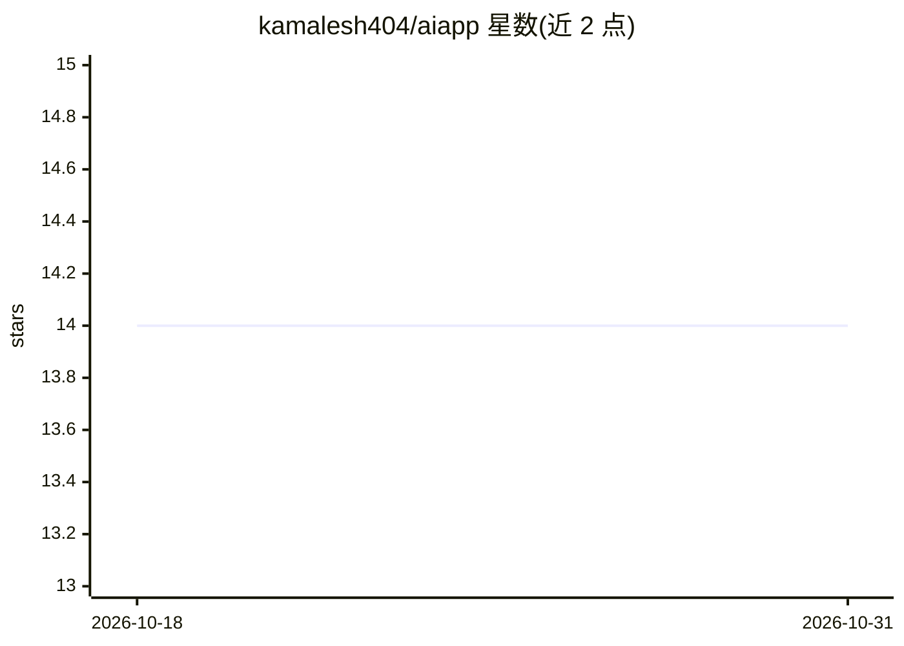

# kamalesh404/aiapp

⭐ 14 · Dart · MIT · 推送 2026-10-25 · [GitHub](https://github.com/kamalesh404/aiapp) · 个人维护

**Flutter 双模式 AI 移动助手：云端 OpenAI 对话与离线本地推理**

跨平台 Flutter 移动应用，提供在线/离线双模式 AI 交互：联网并配置 API key 时经 OpenAI GPT-3.5/GPT-4 流式对话并调用 DALL-E 3 生成 1024×1024 图像；离线时切换到本地确定性关键词匹配推理引擎与基于 Dart image 包的程序化 2D 图案合成（几何/抽象/波纹），全程零网络调用。对话与图像数据以 Hive NoSQL 持久化，架构遵循 Clean Architecture 分层，含单元测试与 GitHub Actions CI。限制：需 Flutter SDK >=3.0.0 从源码构建运行，非成品安装包。

## 筛选速览

| 维度 | 判定 | 备注 |
|---|---|---|
| AI 角色 | `ai-native` | 本体是模型或模型工具 |
| 许可风险 | `permissive` | MIT |
| 部署形态 | `None` |  |
| 模型依赖 | — | README 未给出锁定关系 |
| 硬件要求 | — | 无带数字的原话,不猜 |
| 安装摩擦 | `low` | 无编译、无系统依赖或容器化 |
| 成熟度 | — | 结构信号不足 |

## 能力要点

- 在线 OpenAI GPT-3.5/4 流式对话与 DALL-E 3 图像生成
- 离线模式：规则推理引擎 + 程序化 2D 图案合成，零网络依赖
- Hive NoSQL 持久化对话记录与图像资产
- Clean Architecture 分层，附单元测试与 GitHub Actions CI

## 适用场景

- 我想在手机上体验联网 AI 聊天与文生图
- 无网络环境下仍可使用本地对话与图案生成功能
- 学习 Flutter 中云端/本地双模式 AI 应用架构

## 场景标签

`聊天机器人` `图像生成` · 领域:对话与助手

## 证据(README 行号)

> L5: **A cross-platform Flutter application featuring dual-mode AI interactions: cloud LLM streaming with OpenAI alongsid
> L18: **AI Mobile Assistant** is an architectural exploration of hybrid mobile AI workflows in Flutter. It demonstrates h
> L20: When connected to the internet and provided with an API key, the app streams real-time conversational responses and

## 星数曲线

2026-10-18 14 → 2026-10-31 14（+0）

---
*卡片 v1 · prompt 1.4 · 生成 2026-10-31 · 置信度 high · 依据 README sha `41bc8d7a82de` · [字段定义](../../DATASET.md)*
