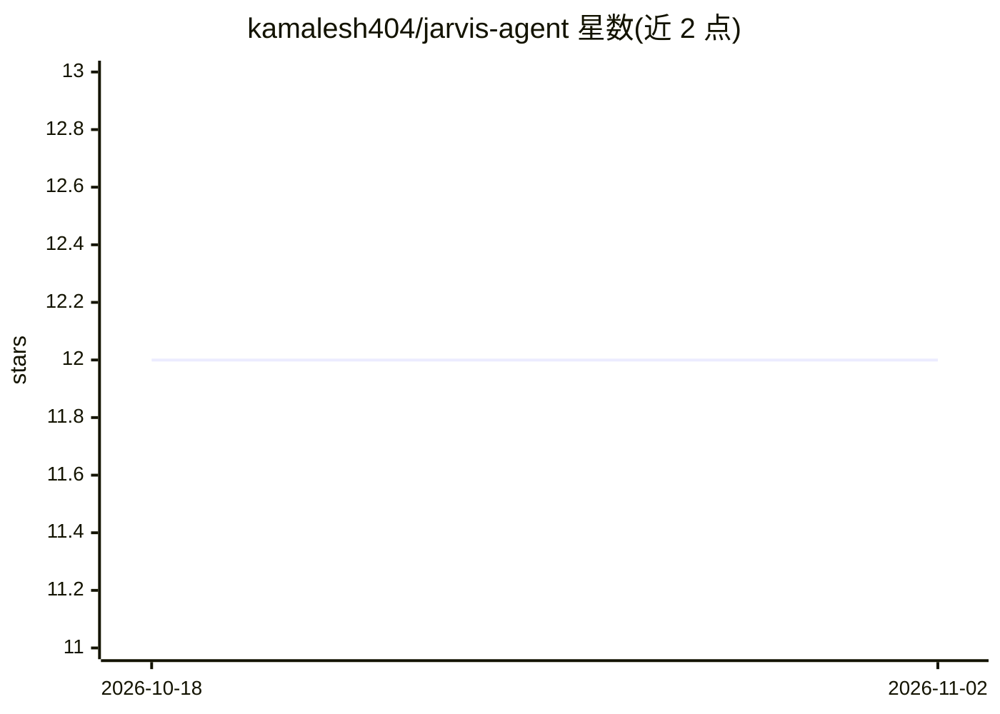

# kamalesh404/jarvis-agent

⭐ 12 · Python · MIT · 推送 2026-06-11 · [GitHub](https://github.com/kamalesh404/jarvis-agent) · 个人维护

**本地运行的 Python 个人 AI 自动化助手：规划、记忆、语音与电脑控制**

用 Python 实现的模块化个人自动化助手，以自主 agent 形式工作：通过 LLM 推理循环将用户请求拆解为可执行步骤，用 PyAutoGUI 直接控制鼠标键盘完成桌面操作，集成 ChromaDB 做长期对话记忆，内置语音识别与 pyttsx3 语音合成，支持插件架构扩展能力，并可在本地生成图像。从源码运行，需先安装 requirements.txt 中的依赖。Roadmap 中的多 agent 通信、Web 仪表盘与外部 API 深度集成尚未实现。

## 筛选速览

| 维度 | 判定 | 备注 |
|---|---|---|
| AI 角色 | `ai-native` | 本体是模型或模型工具 |
| 许可风险 | `permissive` | MIT |
| 部署形态 | `library` | 以包/库形式分发 |
| 模型依赖 | — | README 未给出锁定关系 |
| 硬件要求 | — | 无带数字的原话,不猜 |
| 安装摩擦 | `low` | 无编译、无系统依赖或容器化 |
| 成熟度 | — | 结构信号不足 |

## 能力要点

- LLM 推理循环将复杂请求拆解为可执行步骤
- ChromaDB 长期记忆保存过往对话与上下文
- PyAutoGUI 直接控制点击、输入等桌面操作
- 语音识别 + pyttsx3 TTS 的免手交互与插件架构

## 适用场景

- 用对话或语音指挥电脑自动完成桌面操作任务
- 让助手记住历史对话，提供带上下文的持续协助
- 通过插件扩展自定义自动化能力

## 场景标签

`AI 助手` `GUI 自动化` · 领域:效率与自动化

## 证据(README 行号)

> L9: Jarvis Agent is an intelligent, modular automation assistant built in Python. It goes beyond simple chat—acting as a
> L13: - 🧠 **Autonomous Planning:** Uses an advanced reasoning loop to break down complex user requests into executable st
> L45: ├── brain.py             # LLM interface and AI reasoning

## 星数曲线

2026-10-18 12 → 2026-11-02 12（+0）

---
*卡片 v1 · prompt 1.4 · 生成 2026-11-01 · 置信度 mid · 依据 README sha `76d2e234c878` · [字段定义](../../DATASET.md)*
