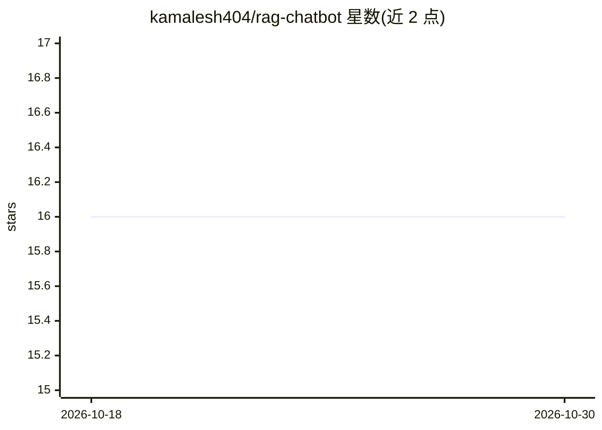

# kamalesh404/rag-chatbot

⭐ 16 · Python · MIT · 推送 2026-08-20 · [GitHub](https://github.com/kamalesh404/rag-chatbot) · 个人维护

**基于 Gemini 与 LangChain 的本地文档问答聊天机器人**

用 Python 编写的 RAG 聊天应用：用户通过 Streamlit 网页界面上传 PDF 或 TXT 文件，系统将文档分块、用 embedding-001 生成嵌入并存储到本地 ChromaDB，随后基于 gemini-1.5-flash 模型检索相关片段生成回答，并显示引用来源。编排采用 LangChain Expression Language (LCEL)。运行需 Python 3.11+ 并配置 Google Gemini API key（.env 文件），通过 git clone 源码安装，streamlit run 启动。

## 筛选速览

| 维度 | 判定 | 备注 |
|---|---|---|
| AI 角色 | `ai-native` | 本体是模型或模型工具 |
| 许可风险 | `permissive` | MIT |
| 部署形态 | `library` | 以包/库形式分发 |
| 模型依赖 | — | README 未给出锁定关系 |
| 硬件要求 | — | 无带数字的原话,不猜 |
| 安装摩擦 | `low` | 无编译、无系统依赖或容器化 |
| 成熟度 | — | 结构信号不足 |

## 能力要点

- 上传 PDF/TXT 后分块、嵌入并存入本地 ChromaDB
- 基于 gemini-1.5-flash 与 embedding-001 的检索问答
- 回答附带来源片段引用（View Sources）
- 用 LangChain Expression Language (LCEL) 编排

## 适用场景

- 上传自己的 PDF 或 TXT 文档并进行问答
- 查看回答所依据的原文片段以核对来源
- 在本地保存文档嵌入向量

## 场景标签

`文档问答` · 领域:知识与检索

## 证据(README 行号)

> L11: - **📄 Chat with your Documents**: Upload `.pdf` or `.txt` files directly in the UI.
> L13: - **⚡ Blazing Fast**: Powered by Google's latest `gemini-1.5-flash` model and `embedding-001`.
> L19: * **AI / LLM:** Google Gemini API

## 星数曲线

2026-10-18 16 → 2026-10-30 16（+0）

---
*卡片 v1 · prompt 1.4 · 生成 2026-10-30 · 置信度 mid · 依据 README sha `81db07f93169` · [字段定义](../../DATASET.md)*
