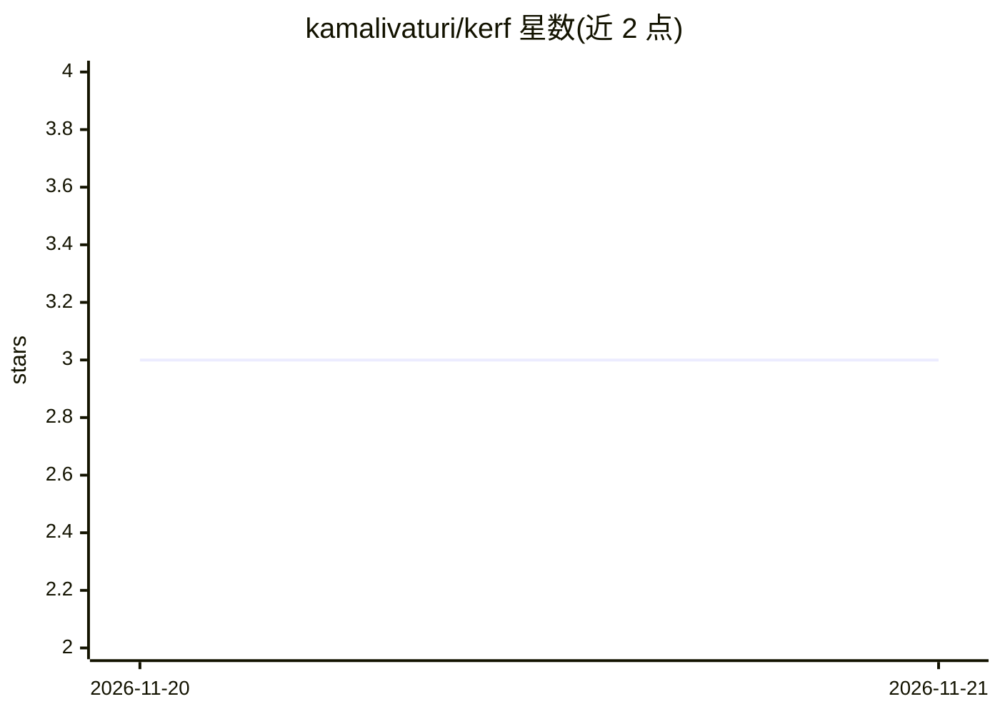

# kamalivaturi/kerf

⭐ 3 · Python · MIT · 推送 2026-11-06 · [GitHub](https://github.com/kamalivaturi/kerf) · [官网](https://kamalivaturi.github.io/kerf/) · 个人维护

**为 Premiere/After Effects/Resolve 添加静音剪切、字幕与动效的编辑工具包**

以面板形式接入 Premiere Pro 与 After Effects、以 OpenFX 效果形式接入 DaVinci Resolve 的剪辑工具包：读取打开的时间线，执行去静音、逐词字幕、变速、镜头抖动、稳定、锚点与图层工具等操作，生成新序列/片段/标记而不改动原始剪辑。AI 相关功能包括 Whisper 转录、Silero 语音检测、U²-Net 抠像、本地 Kokoro 旁白配音，以及调用 Claude/OpenAI/Gemini 或本地模型的 Prompt Edit。本地运行，无需账号与密钥；转录大模型需 NVIDIA GPU，否则用小模型。

## 筛选速览

| 维度 | 判定 | 备注 |
|---|---|---|
| AI 角色 | `ai-enhanced` | 去掉 AI 部分产品仍成立 |
| 许可风险 | `permissive` | MIT |
| 部署形态 | `desktop` | 安装包/桌面程序 |
| 模型依赖 | local-ok | 支持本地模型 |
| 硬件要求 | — | 无带数字的原话,不猜 |
| 安装摩擦 | `medium` | 含编译或系统依赖之一 |
| 成熟度 | — | 结构信号不足 |

## 能力要点

- 一键去除静音、口头语与废镜头，剪切前可预览确认
- Whisper 转录与 21 种混语字幕配置，支持 194 个可编辑 MOGRT 模板
- Kokoro 本地语音合成 54 种声音，FFmpeg vidstab 一键稳定
- Prompt Edit 由 LLM 规划并执行 Kerf 功能链，支持本地模型

## 适用场景

- 批量剪切访谈/播客素材中的静音与口头语
- 给短视频生成逐词动画字幕并适配 9:16 安全区
- 在时间线上快速加变速、抖动、缩放等动效
- 把长视频改剪为带人脸追踪竖屏重构图的短片

## 场景标签

`语音识别` `语音合成` `图像视频处理` · 领域:内容生成

## 证据(README 行号)

> L22: Kerf is a **free, open-source editing toolkit**. It adds a panel to **Premiere Pro** and **After Effects**, and an
> L78: |🤖 **AI**|**Prompt Edit**|Type what you want. Claude, OpenAI, Gemini or a local model plans a chain of Kerf feature

## 星数曲线

2026-11-20 3 → 2026-11-21 3（+0）

---
*卡片 v1 · prompt 1.4 · 生成 2026-11-21 · 置信度 mid · 依据 README sha `c0aafb144691` · [字段定义](../../DATASET.md)*
