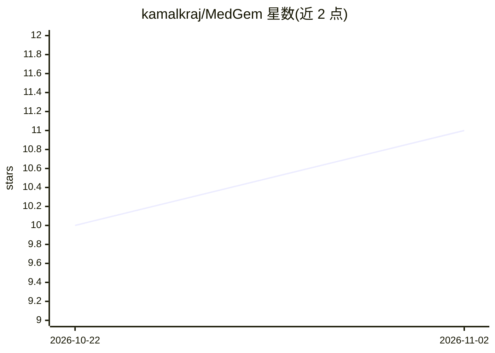

# kamalkraj/MedGem

⭐ 11 · Kotlin · MIT · 推送 2026-02-24 · [GitHub](https://github.com/kamalkraj/MedGem) · [官网](https://www.kaggle.com/competitions/med-gemma-impact-challenge/writeups/MedGem) · 个人维护

**在 Android 设备上离线运行医学多模态大模型的应用**

Kotlin Jetpack Compose 构建的 Android 应用，在本地离线运行 MedGemma-1.5-4B 医学多模态大模型，支持文本与医学影像（X 光、扫描）处理。通过 ExecuTorch、ONNX(sherpa-onnx)、LiteRT 三种运行时分别部署主模型、MedASR 语音与 EmbeddingGemma 嵌入模型。内置预置医学知识库的 RAG、SOAP 病历生成、思维链推理、协议 PDF 离线查看等功能。要求 Android 14+、12GB RAM（8GB 可禁用视觉编码器仅载文本模型）、约 4GB 存储空间；提供 APK 下载，模型需另行下载并 adb 推送。

## 筛选速览

| 维度 | 判定 | 备注 |
|---|---|---|
| AI 角色 | `ai-native` | 本体是模型或模型工具 |
| 许可风险 | `permissive` | MIT |
| 部署形态 | `None` |  |
| 模型依赖 | — | README 未给出锁定关系 |
| 硬件要求 | — | 无带数字的原话,不猜 |
| 安装摩擦 | `low` | 无编译、无系统依赖或容器化 |
| 成熟度 | `idea` | |

## 能力要点

- 三运行时分工部署：主模型(ExecuTorch)、MedASR(ONNX)、嵌入模型(LiteRT)
- 预置医学知识库的 RAG 与语义检索
- 患者管理与 AI 生成 SOAP 病历笔记
- 量化模型与 HuggingFace 原版对比评测报告

## 适用场景

- 无网络环境下查看医学影像并获取模型分析
- 诊疗过程中生成结构化 SOAP 病历
- 离线检索内置医学知识库与协议 PDF

## 场景标签

`RAG` `多模态` · 领域:知识与检索

## 证据(README 行号)

> L11: MEDGEM is an offline inference engine for **MedGemma-1.5-4B**, a medical-domain Multimodal Large Language Model (ML
> L21: - **Offline Inference**: Run models locally for maximum data privacy and security.

## 星数曲线

2026-10-22 10 → 2026-11-02 11（+1）

---
*卡片 v1 · prompt 1.4 · 生成 2026-11-02 · 置信度 high · 依据 README sha `152387fe3c84` · [字段定义](../../DATASET.md)*
