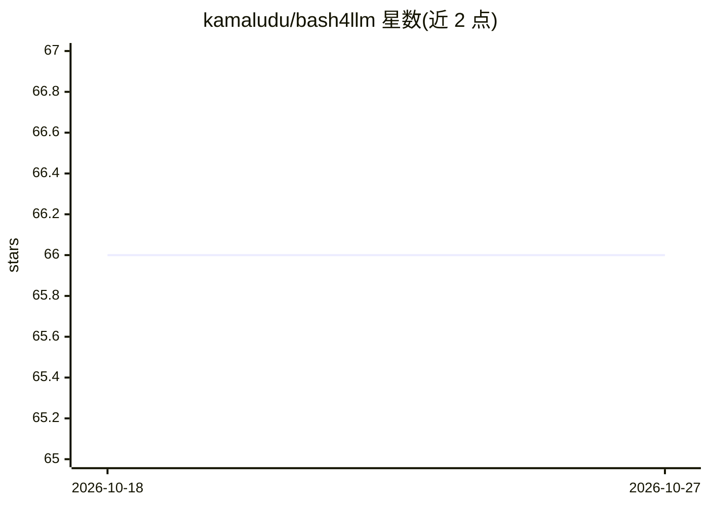

# kamaludu/bash4llm

⭐ 66 · Shell · GPL-3.0 · 推送 2026-10-08 · [GitHub](https://github.com/kamaludu/bash4llm) · [官网](https://kamaludu.github.io/bash4llm/) · 个人维护

**纯 Bash 实现的 LLM API 命令行调用工具，供开发者在终端直接使用模型**

面向开发者的 LLM API 包装器：核心为单文件 Bash 脚本，仅依赖 POSIX 标准命令（bash 4.0+、curl、jq 等），默认接入 Groq，通过 extras 模块扩展 Gemini、Mistral、HuggingFace 等 OpenAI 兼容后端。提供 CLI 单次调用、管道输入、多轮会话线程、批量执行，以及纯 Bash TUI REPL；可选 Python/FastAPI 浏览器 WebApp（需 Python 3.10+）。内置多项安全机制：API 密钥 OpenSSL 加密保管、进程表密钥泄漏检测、模块 SHA-256 清单与 Ed25519 签名校验。兼容 Linux/macOS/WSL/Cygwin/Termux/BSD。

## 筛选速览

| 维度 | 判定 | 备注 |
|---|---|---|
| AI 角色 | `ai-native` | 本体是模型或模型工具 |
| 许可风险 | `viral` | GPL-3.0 |
| 部署形态 | `library` | 以包/库形式分发 |
| 模型依赖 | locked-api |  |
| 硬件要求 | — | 无带数字的原话,不猜 |
| 安装摩擦 | `low` | 无编译、无系统依赖或容器化 |
| 成熟度 | — | 结构信号不足 |

## 能力要点

- 核心为零外部依赖的 Bash 脚本，CLI/TUI 100% 原生 Bash
- 动态拉取 provider 模型列表，无硬编码模型标识
- API 密钥 AES-256-CBC/PBKDF2 本地加密保管（--vault）
- 模块加载经 SHA-256 清单与 Ed25519 签名校验，支持 Termux/Android

## 适用场景

- 在终端或脚本/管道中直接调用 LLM API 完成生成与分析任务
- 在 Termux/Android 等无重型运行时的环境使用 LLM
- 以多轮线程与批量文件方式跑提示词任务

## 场景标签

`模型网关` · 领域:Agent 开发

## 证据(README 行号)

> L19: Wrapper in ambiente Bash per l'interfacciamento con API LLM compatibili con lo standard OpenAI. Integra un provider
> L88: ./bash4llm "Fornisci una spiegazione del protocollo SSH."

## 星数曲线

2026-10-18 66 → 2026-10-27 66（+0）

---
*卡片 v1 · prompt 1.4 · 生成 2026-10-24 · 置信度 mid · 依据 README sha `d87a05ce2931` · [字段定义](../../DATASET.md)*
