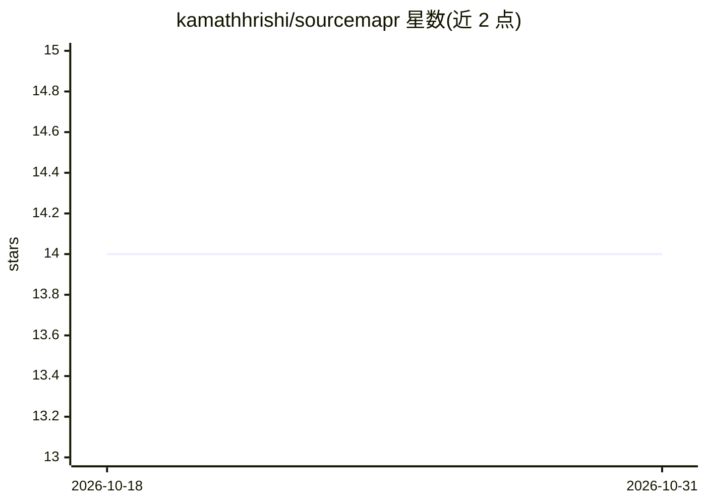

# kamathhrishi/sourcemapr

⭐ 14 · Python · 推送 2025-12-29 · [GitHub](https://github.com/kamathhrishi/sourcemapr) · [官网](https://kamathhrishi.github.io/sourcemapr/) · 个人维护

**RAG 检索可观测性工具：两行代码追溯回答出处**

检索观测与调试工具：在 LlamaIndex、LangChain、OpenAI 调用链路中通过 init_tracing 两行接入，捕获文档加载→解析→分块→嵌入→检索→回答的完整证据链路，记录提示词、响应、token 数与延迟，支持在原始 PDF 中高亮查看被检索分块、实验对比不同分块策略。人类通过本地 dashboard 审查，AI agent 可通过内置 MCP Server 读写数据并写入 LLM-as-judge 评估。以 pip 包与本地服务器（CLI 启动）形式提供，PDF 支持完整，HTML 及 pipeline 追踪为实验性。

## 筛选速览

| 维度 | 判定 | 备注 |
|---|---|---|
| AI 角色 | `ai-ecosystem` | LLM/agent 周边工具 |
| 许可风险 | `none` | — |
| 部署形态 | `library` | 以包/库形式分发 |
| 模型依赖 | — | README 未给出锁定关系 |
| 硬件要求 | — | 无带数字的原话,不猜 |
| 安装摩擦 | `low` | 无编译、无系统依赖或容器化 |
| 成熟度 | `idea` | |

## 能力要点

- 两行代码接入，追踪回答到具体分块及相似度分数
- 完整证据链路：文档→分块→嵌入→检索→回答
- 内置 MCP Server，AI agent 可读取数据并写入 LLM-as-judge 评估
- 实验跟踪与分块策略对比，PDF 分块高亮查看

## 适用场景

- 调试 RAG 管线，定位幻觉与检索问题
- 对比不同分块策略的检索效果
- 让 AI agent 通过 MCP 自动评估查询的相关性与忠实度

## 场景标签

`LLM 可观测性` · 领域:评测与运维

## 证据(README 行号)

> L10: SourceMapR is a retrieval observability tool. Trace every LLM answer back to exact document evidence — in two lines
> L84: - **MCP Server** — AI agents can read data and write evaluations via Model Context Protocol

## 星数曲线

2026-10-18 14 → 2026-10-31 14（+0）

---
*卡片 v1 · prompt 1.4 · 生成 2026-10-31 · 置信度 high · 依据 README sha `ce073b50d0c8` · [字段定义](../../DATASET.md)*
