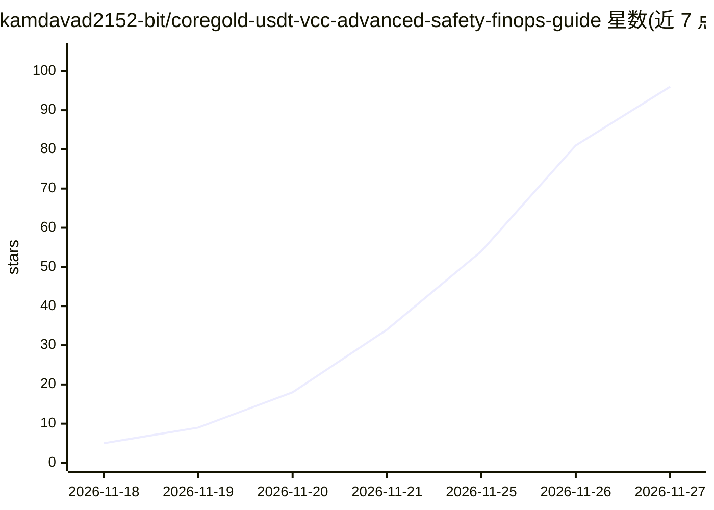

# kamdavad2152-bit/coregold-usdt-vcc-advanced-safety-finops-guide

⭐ 96 · 推送 2026-11-17 · [GitHub](https://github.com/kamdavad2152-bit/coregold-usdt-vcc-advanced-safety-finops-guide) · [官网](https://app.coregold.io/signup?invite_code=ADvlj9b) · 个人维护 · 中文 README

**面向海外 AI 订阅用户的虚拟卡安全与预算治理教程**

一篇以 CoreGold 商业虚拟卡为主题的进阶教程，内容为虚拟卡的安全配置与财务管理方法：多卡隔离绑定不同订阅服务、发卡时设置单卡硬限额以拦截超额扣款、按收单网关校验要求手动配置 AVS 账单地址、以及用完即销卡并回收余额的生命周期管理。目标读者为高频订阅 ChatGPT、Claude、Cursor 及海外云服务的开发者和工作室。文末含指向官方后台的链接，全文以单一服务商操作流程为主。

## 筛选速览

| 维度 | 判定 | 备注 |
|---|---|---|
| AI 角色 | `ai-knowledge` | 知识聚合/清单类 |
| 许可风险 | `none` | — |
| 部署形态 | `None` |  |
| 模型依赖 | — | README 未给出锁定关系 |
| 硬件要求 | — | 无带数字的原话,不猜 |
| 安装摩擦 | `low` | 无编译、无系统依赖或容器化 |
| 成熟度 | — | 结构信号不足 |

## 能力要点

- 单卡硬限额配置流程（含建议额度计算方式）
- 手动 AVS 账单地址录入与一致性原则说明
- 一服务一专卡的多卡隔离管理策略
- 销卡后余额回流母账户的生命周期操作

## 适用场景

- 为多个海外 AI 订阅服务分别开卡隔离扣款
- 限制自动化脚本的月度消费上限
- 短期项目结束后销卡回收余额

## 场景标签

`教程课程` · 领域:学习与行业

## 证据(README 行号)

> L2: CoreGold 进阶安全运维与 FinOps 治理指南：深度解析如何通过单卡硬限额、动态 AVS 地址对齐与生命周期管理，全面规避海外 AI 订阅的自动续费漏洞与高频脚本死循环风险。
> L9: 本篇进阶教程将带你深入挖掘 CoreGold 的高级安全特性，教你如何建立“一服务一专卡、用完即焚、硬限额熔断”的现代化 AI FinOps（财务运维）管理流。
> L45: 👉 **点击访问 CoreGold 官方后台管理你的专属虚拟卡**

## 星数曲线

2026-11-18 5 → 2026-11-27 96（+91）

---
*卡片 v1 · prompt 1.4 · 生成 2026-11-20 · 置信度 high · 依据 README sha `72234cce69b3` · [字段定义](../../DATASET.md)*
