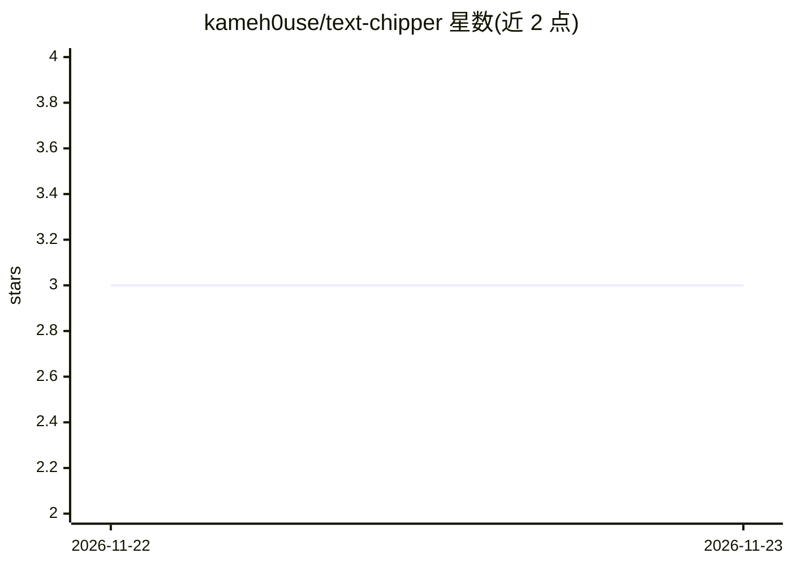

# kameh0use/text-chipper

⭐ 3 · Rust · Apache-2.0 · 推送 2026-11-21 · [GitHub](https://github.com/kameh0use/text-chipper) · 个人维护

**RAG/LLM 流水线的 Markdown 感知、严格 token 预算文本分块库**

以 Rust 编写、通过 PyO3 提供 Python 绑定的文本分块库：保证每个 chunk 的 token_count 不超过 max_length，交付形态（含标题前缀与重复表头）按原样重算 token。解析 Markdown 标题层级、围栏代码块、列表与 GFM 表格；超预算表格按行边界切分并在每个续块重复表头。提供严格/平坦两种模式、有界内存流式读取大文件、图素安全切分与还原原文的精确偏移量，并通过 PyPI 预编译 wheel 或 crates.io 提供，另含 LangChain/LlamaIndex 适配器目录。

## 筛选速览

| 维度 | 判定 | 备注 |
|---|---|---|
| AI 角色 | `ai-ecosystem` | LLM/agent 周边工具 |
| 许可风险 | `permissive` | Apache-2.0 |
| 部署形态 | `library` | 以包/库形式分发 |
| 模型依赖 | — | README 未给出锁定关系 |
| 硬件要求 | — | 无带数字的原话,不猜 |
| 安装摩擦 | `low` | 无编译、无系统依赖或容器化 |
| 成熟度 | — | 结构信号不足 |

## 能力要点

- strict 模式下逐块重算交付文本 token，保证 token_count <= max_length
- GFM 表格超预算时按行边界切分并在续块重复表头行
- from_file_stream() 有界内存流式处理大文件，支持 Python 与 Rust 双语言 API
- 支持内置 BPE 编码、tokenizer.json、Hugging Face tokenizer 对象与自定义计数函数

## 适用场景

- 为 RAG 检索管线生成不超过嵌入模型 token 上限的文本块
- 切分含长表格和代码块的 Markdown 文档并保留列头上下文
- 流式处理数百 MiB 的大文本文件而不爆内存
- 在 Python 与 Rust 项目中复用同一套分块逻辑

## 场景标签

`RAG` `文档解析` · 领域:知识与检索

## 证据(README 行号)

> L5: **High-performance, Markdown- and table-aware, strictly budget-enforced text chunking for RAG and LLM pipelines.
> L64: Adapters for LangChain and LlamaIndex are in `integrations/`.
> L25: Install from PyPI (pre-built `abi3` wheels for Python ≥ 3.9 include the Rust core and Hugging Face `tokenizers` sup

## 星数曲线

2026-11-22 3 → 2026-11-23 3（+0）

---
*卡片 v1 · prompt 1.4 · 生成 2026-11-22 · 置信度 high · 依据 README sha `6cc42146cac2` · [字段定义](../../DATASET.md)*
