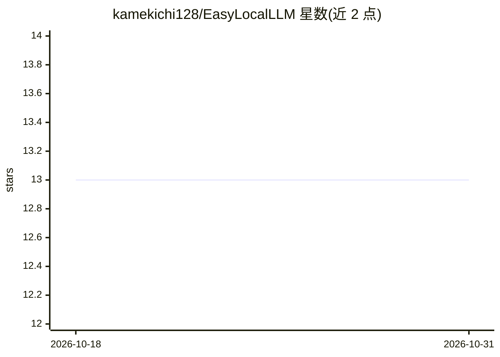

# kamekichi128/EasyLocalLLM

⭐ 13 · C# · MIT · 推送 2026-04-19 · [GitHub](https://github.com/kamekichi128/EasyLocalLLM) · [官网](https://kamekichi128.github.io/kamekichi-games/) · 个人维护

**Unity 库：让游戏接入本地 LLM（Ollama/wllama）实现离线对话**

面向 Unity 开发者的本地 LLM 接入库，支持 Ollama 与 wllama 两种运行时，最少 3 行代码即可搭建离线聊天或游戏内 NPC 对话。机制包括流式响应、指数退避自动重试、多会话管理、按会话设置系统提示词、Function Calling 调用游戏功能、加密聊天历史持久化。要求 Unity 2021.3+，支持 Windows 10/11 与 WebGL，依赖 Ollama 服务器与 Newtonsoft.Json，推荐 GPU。附 SimpleChat、VLM 图像理解等示例场景。

## 筛选速览

| 维度 | 判定 | 备注 |
|---|---|---|
| AI 角色 | `ai-ecosystem` | LLM/agent 周边工具 |
| 许可风险 | `permissive` | MIT |
| 部署形态 | `None` |  |
| 模型依赖 | local-ok | 支持本地模型 |
| 硬件要求 | — | 无带数字的原话,不猜 |
| 安装摩擦 | `low` | 无编译、无系统依赖或容器化 |
| 成熟度 | — | 结构信号不足 |

## 能力要点

- 支持 Ollama 与 wllama 两种本地 LLM 运行时
- 流式响应、自动重试与多会话管理
- Function Calling 可从 LLM 调用游戏功能
- 聊天历史加密持久化

## 适用场景

- 在 Unity 游戏中为 NPC 加入本地 LLM 对话
- 构建离线可运行的 AI 聊天机器人
- 用 VLM（如 qwen3-VL）实现游戏内图像理解

## 场景标签

`聊天机器人` `多模态` · 领域:对话与助手

## 证据(README 行号)

> L7: EasyLocalLLM is a Unity library that makes it easy to use a local LLM (Ollama / wllama). With just a few lines of co
> L80: - Unity-only (depends on UnityWebRequest)

## 星数曲线

2026-10-18 13 → 2026-10-31 13（+0）

---
*卡片 v1 · prompt 1.4 · 生成 2026-10-31 · 置信度 high · 依据 README sha `6967fdad28cb` · [字段定义](../../DATASET.md)*
