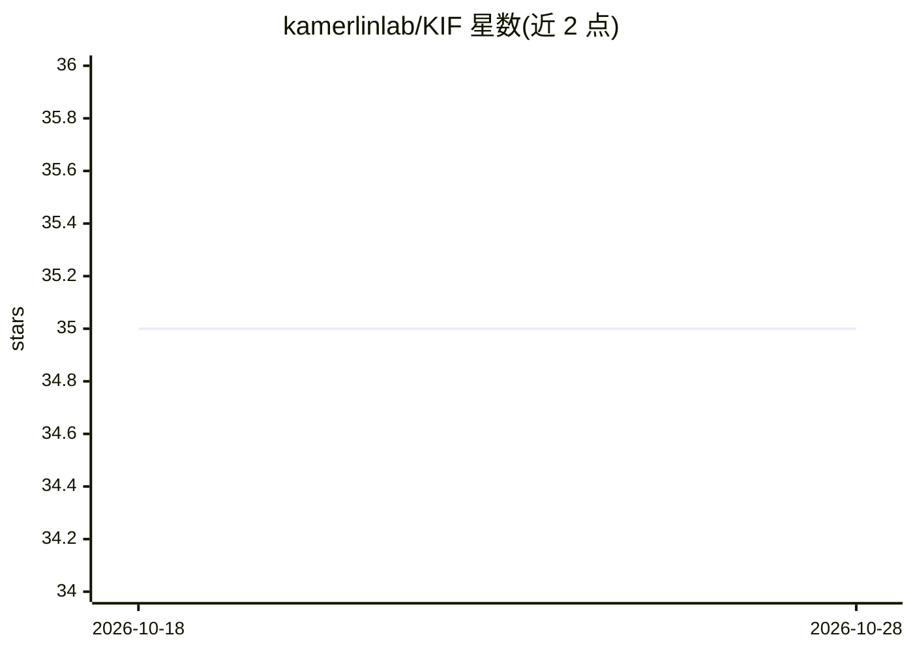

# kamerlinlab/KIF

⭐ 35 · Python · GPL-2.0 · 推送 2026-08-08 · [GitHub](https://github.com/kamerlinlab/KIF) · [官网](https://kamerlinlab.github.io/KIF/) · 组织维护

**从 MD 轨迹识别调控构象变化的关键分子相互作用的 Python 包**

面向分子动力学研究的 Python 包：读取 MD 轨迹帧，识别其中全部非共价相互作用作为特征，结合用户自定义的目标变量（连续或分类），通过机器学习、统计分析或网络分析对相互作用按其与构象变化的关联度打分，并可转换为逐残基分数；生成 PyMOL 与 ChimeraX 可视化脚本及残基相关性/距离矩阵。要求轨迹先完成 imaging 去除周期性效应；0.2.0 起不再依赖 PyContact。提供多篇教程（PTP1B、KE07、PDZ3 等）。

## 筛选速览

| 维度 | 判定 | 备注 |
|---|---|---|
| AI 角色 | `ai-native` | 本体是模型或模型工具 |
| 许可风险 | `viral` | GPL-2.0 |
| 部署形态 | `library` | 以包/库形式分发 |
| 模型依赖 | — | README 未给出锁定关系 |
| 硬件要求 | — | 无带数字的原话,不猜 |
| 安装摩擦 | `low` | 无编译、无系统依赖或容器化 |
| 成熟度 | — | 结构信号不足 |

## 能力要点

- 识别轨迹中全部非共价相互作用并按与构象变化的关联打分
- 支持机器学习、统计与图论网络分析，分数可转换为逐残基分数
- 生成 PyMOL（0.4.0 起支持 ChimeraX）可视化脚本
- 目标变量可自定义，支持连续回归与分类变量

## 适用场景

- 分析酶催化或构象变化（如 PTP1B WPD-loop 开合）的关键相互作用
- 用图论方法研究蛋白质相互作用网络与别构
- 在 3D 结构上可视化关键相互作用分析结果

## 场景标签

 · 领域:计算生物学/生物物理

## 证据(README 行号)

> L20:  - Identify important non-covalent interactions that are associated with any conformational change you are interest
> L36: 3. Load your non-covalent interactions data and optionally generated target data into KIF and perform some combinat

## 星数曲线

2026-10-18 35 → 2026-10-28 35（+0）

---
*卡片 v1 · prompt 1.4 · 生成 2026-10-25 · 置信度 high · 依据 README sha `45341fcd3bc9` · [字段定义](../../DATASET.md)*
