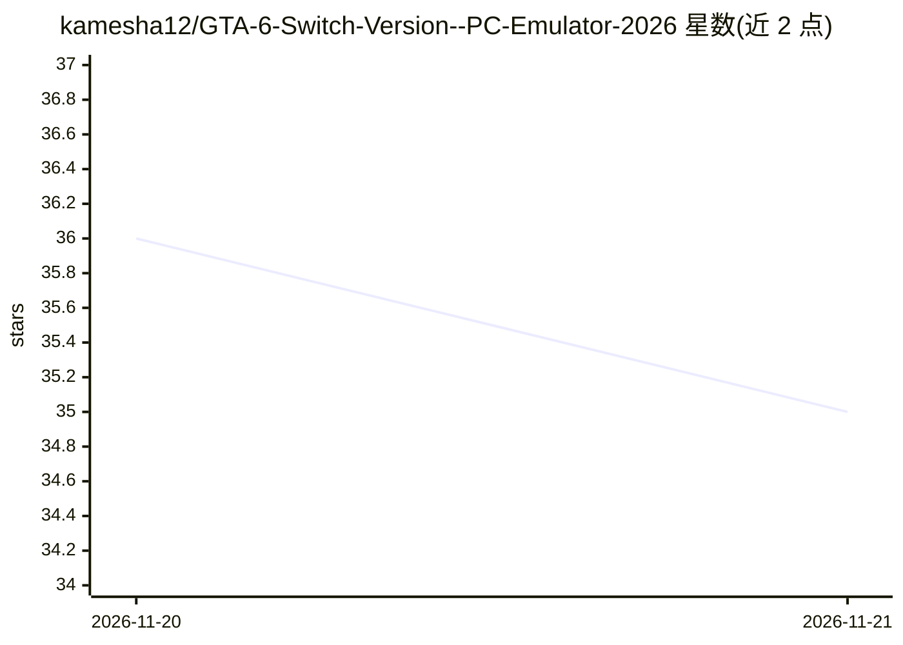

# kamesha12/GTA-6-Switch-Version--PC-Emulator-2026

⭐ 35 · Rust · Apache-2.0 · 推送 2026-11-19 · [GitHub](https://github.com/kamesha12/GTA-6-Switch-Version--PC-Emulator-2026) · 个人维护

**GTA VI Windows 版安装准备与配置指南站点**

面向 Windows 10/11 用户的 GTA VI PC 版准备型资源站：提供系统兼容检查、显卡驱动更新指引、存储检查、Rockstar Games Launcher 准备、图形设置与 FPS 排障建议。项目自称提供一个不含游戏文件的 Windows 配套安装器（.exe）。README 明确 PC 版尚未公布发售日期与官方配置，多数要求标注为未确认，设置文档承诺待官方信息发布后补充。

## 筛选速览

| 维度 | 判定 | 备注 |
|---|---|---|
| AI 角色 | `ai-enhanced` | 去掉 AI 部分产品仍成立 |
| 许可风险 | `permissive` | Apache-2.0 |
| 部署形态 | `desktop` | 安装包/桌面程序 |
| 模型依赖 | — | README 未给出锁定关系 |
| 硬件要求 | — | 无带数字的原话,不猜 |
| 安装摩擦 | `low` | 无编译、无系统依赖或容器化 |
| 成熟度 | `idea` | |

## 能力要点

- Windows 兼容性准备清单（DirectX、驱动、存储检查）
- FPS 与卡顿问题的常规排障指引
- 常见安装错误类别整理
- README 声明配套安装器不含 GTA VI 游戏文件

## 适用场景

- 为未来 GTA VI PC 版提前准备 Windows 环境
- 排查 PC 游戏常见的低帧率与卡顿问题
- 更新显卡驱动与配置 Rockstar Games Launcher

## 场景标签

 · 领域:游戏/桌面工具

## 证据(README 行号)

> L5: A dedicated PC installation and configuration resource for Grand Theft Auto VI, covering Windows preparation, graphi
> L49: The companion installer does not contain or install GTA VI game files.

## 星数曲线

2026-11-20 36 → 2026-11-21 35（-1）

---
*卡片 v1 · prompt 1.4 · 生成 2026-11-20 · 置信度 mid · 依据 README sha `6954d37a13d3` · [字段定义](../../DATASET.md)*
