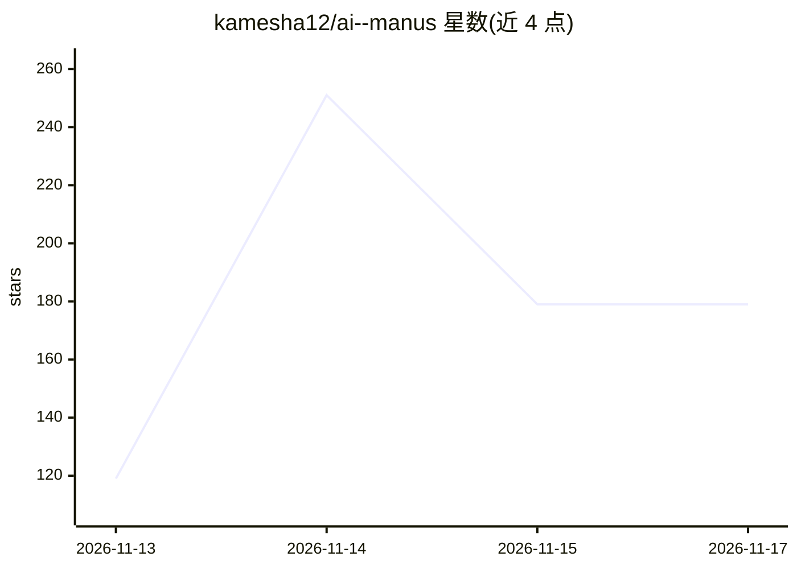

# kamesha12/ai--manus

⭐ 179 · Apache-2.0 · 推送 2026-11-15 · [GitHub](https://github.com/kamesha12/ai--manus) · 个人维护

**面向个人用户自主执行代码与浏览器操作的 AI Agent**

Manus 是一个自主 AI Agent 系统，在沙箱环境中运行代码并控制浏览器：可编写与执行脚本、打开网页、与页面元素交互、执行多步骤任务。README 面向学生、远程工作者等非开发者用户，定位为家庭、学习与轻量办公场景的后台个人助手。兼容性表列出最低双核 CPU、4GB 内存等要求。README 未提供具体安装命令、技术栈或代码入口，仅给出准备、配置、测试等使用步骤描述，且带有促销码与搜索词堆砌内容。

## 筛选速览

| 维度 | 判定 | 备注 |
|---|---|---|
| AI 角色 | `ai-native` | 本体是模型或模型工具 |
| 许可风险 | `permissive` | Apache-2.0 |
| 部署形态 | `None` |  |
| 模型依赖 | — | README 未给出锁定关系 |
| 硬件要求 | — | 无带数字的原话,不猜 |
| 安装摩擦 | `low` | 无编译、无系统依赖或容器化 |
| 成熟度 | — | 结构信号不足 |

## 能力要点

- 自主执行代码完成脚本编写与运行
- 浏览器控制：导航网页、填写表单、收集信息
- 代码与浏览器操作可在一个工作流中衔接
- 多步骤任务可在最少监督下执行

## 适用场景

- 让代理代为收集网页资料并整理研究笔记
- 自动填写重复性表单与执行小型脚本
- 日常小任务的后台委托执行

## 场景标签

`AI 助手` `浏览器自动化` · 领域:效率与自动化

## 证据(README 行号)

> L10: - **Autonomous Code Execution:** Manus AI agent runs code on its own to complete tasks, so you can focus on decisio
> L18: Manus is an autonomous AI agent designed to run code and control a browser on your behalf. Instead of acting like a
> L22: Manus is not a heavy studio suite or a complex enterprise platform. It is a focused helper built for home, study, a

## 星数曲线

2026-11-13 119 → 2026-11-17 179（+60）

---
*卡片 v1 · prompt 1.4 · 生成 2026-11-17 · 置信度 mid · 依据 README sha `0f78ee3a5dd2` · [字段定义](../../DATASET.md)*
