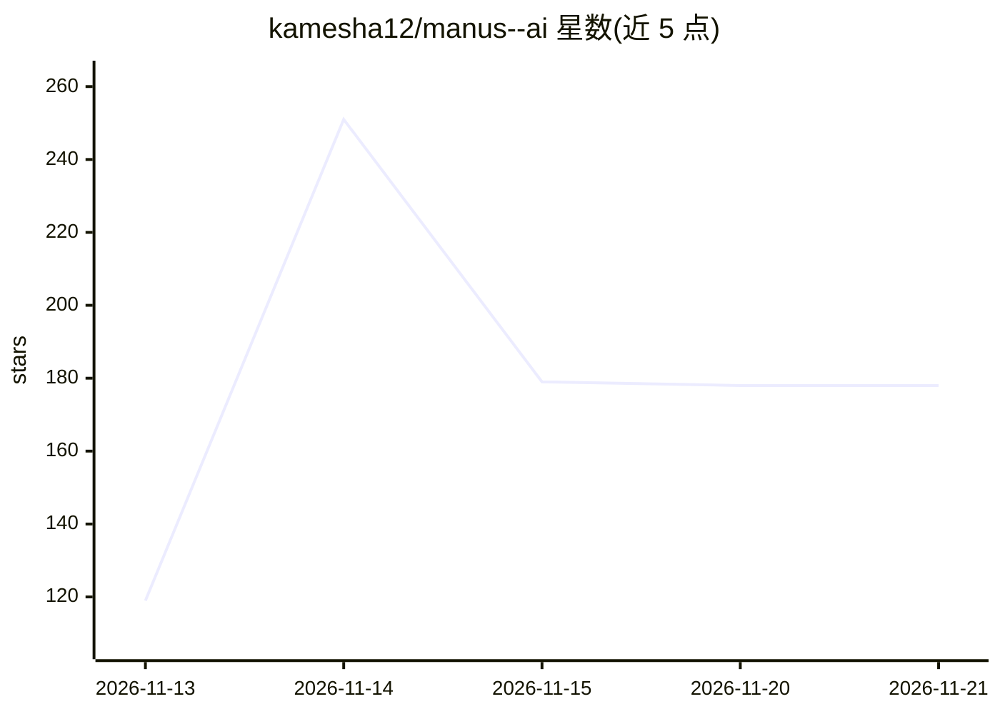

# kamesha12/manus--ai

⭐ — · [GitHub]() · 个人维护

**面向个人用户的自主 AI Agent，代为执行代码与浏览器操作**

README 将 Manus 描述为一个自主运行的 AI Agent：可自行编写并执行脚本、控制浏览器（打开页面、填写表单、采集信息），并支持后台常驻的个人助理模式，用于处理多步骤的日常小任务。定位为面向家庭、学习与轻量办公场景，非企业级平台；支持跨会话保持任务模式。文中给出系统兼容性最低要求（64 位系统、双核 CPU、4 GB 内存），并提供下载入口与六步使用流程说明。

## 筛选速览

| 维度 | 判定 | 备注 |
|---|---|---|
| AI 角色 | `ai-native` | 本体是模型或模型工具 |
| 许可风险 | `permissive` | — |
| 部署形态 | `None` |  |
| 模型依赖 | — | README 未给出锁定关系 |
| 硬件要求 | — | 无带数字的原话,不猜 |
| 安装摩擦 | `low` | 无编译、无系统依赖或容器化 |
| 成熟度 | — | 结构信号不足 |

## 能力要点

- 自主执行代码与浏览器控制（导航页面、填表、采集信息）
- 后台常驻的个人助理模式，处理提醒与例行任务
- 跨会话保持已学工作流模式
- 声明支持 64 位系统，最低 4 GB 内存

## 适用场景

- 让 Agent 自动收集多个网页的信息做研究整理
- 自动填写重复性表单和例行网页操作
- 运行小脚本做快速计算或实验

## 场景标签

`AI 助手` `浏览器自动化` · 领域:效率与自动化

## 证据(README 行号)

> L18: Manus is an autonomous AI agent designed to run code and control a browser on your behalf. Instead of acting like a
> L41: |**Memory (RAM)**|4 GB|8 GB or more for heavy Manus autonomous tasks|

## 星数曲线

2026-11-13 119 → 2026-11-21 178（+59）

---
*卡片 v1 · prompt 1.4 · 生成 2026-11-20 · 置信度 mid · 依据 README sha `148cfe63626f` · [字段定义](../../DATASET.md)*
