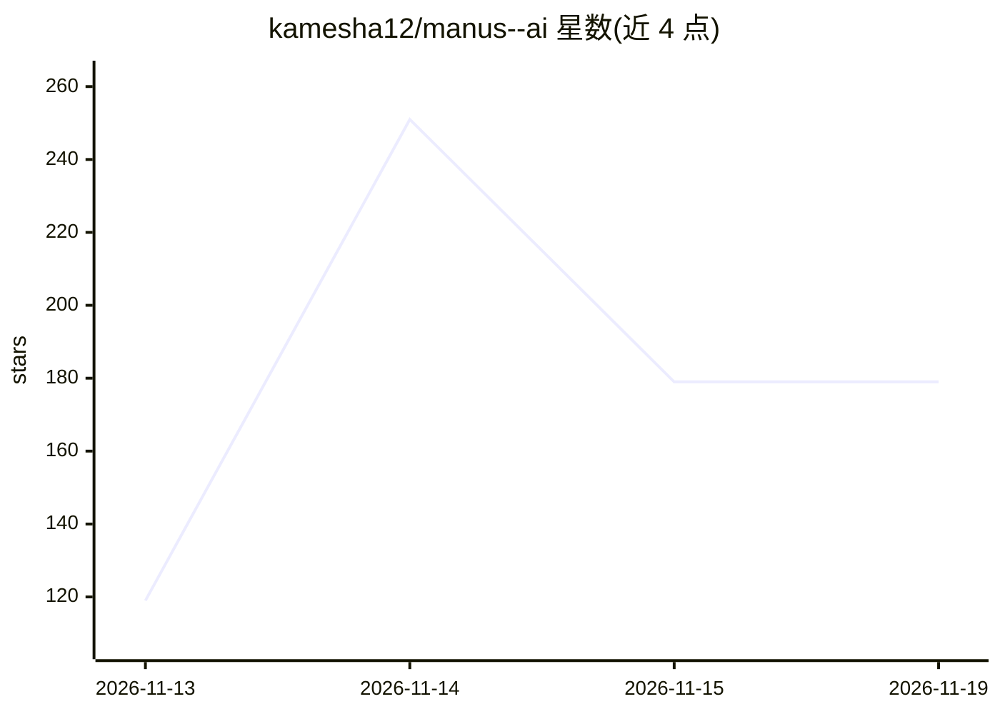

# kamesha12/manus--ai

⭐ 179 · Apache-2.0 · 推送 2026-11-18 · [GitHub](https://github.com/kamesha12/manus--ai) · 个人维护

**通用 AI Agent 助手：代用户执行代码与浏览器操作**

定位为通用自主 AI Agent 系统，核心机制包括自主代码执行（代写并运行脚本）、浏览器控制（导航网页、填写表单、采集信息）与多步骤任务自动化，可在沙盒环境中运行各类工具。目标用户为学生、远程办公者及处理多个小项目的普通用户，强调无需深度技术背景，适用于家庭、学习与轻量办公场景。README 以介绍性内容为主，未给出具体安装命令或源码构建说明，仅提示下载入口。

## 筛选速览

| 维度 | 判定 | 备注 |
|---|---|---|
| AI 角色 | `ai-native` | 本体是模型或模型工具 |
| 许可风险 | `permissive` | Apache-2.0 |
| 部署形态 | `None` |  |
| 模型依赖 | — | README 未给出锁定关系 |
| 硬件要求 | — | 无带数字的原话,不猜 |
| 安装摩擦 | `low` | 无编译、无系统依赖或容器化 |
| 成熟度 | — | 结构信号不足 |

## 能力要点

- 自主代码执行：代写并运行脚本完成任务
- 浏览器控制：导航网页、填写表单、采集信息
- 多步骤自主任务自动化，跨会话保持任务模式
- 面向家庭、学习与轻量办公的小规模任务设计

## 适用场景

- 收集资料并整理学习研究笔记
- 自动填写重复表单、从多个网页采集数据
- 将日常重复性小任务交给后台助手处理

## 场景标签

`AI 助手` `浏览器自动化` · 领域:效率与自动化

## 证据(README 行号)

> L18: Manus is an autonomous AI agent designed to run code and control a browser on your behalf. Instead of acting like a
> L22: Manus is not a heavy studio suite or a complex enterprise platform. It is a focused helper built for home, study, a

## 星数曲线

2026-11-13 119 → 2026-11-19 179（+60）

---
*卡片 v1 · prompt 1.4 · 生成 2026-11-19 · 置信度 mid · 依据 README sha `c06c32a8c955` · [字段定义](../../DATASET.md)*
