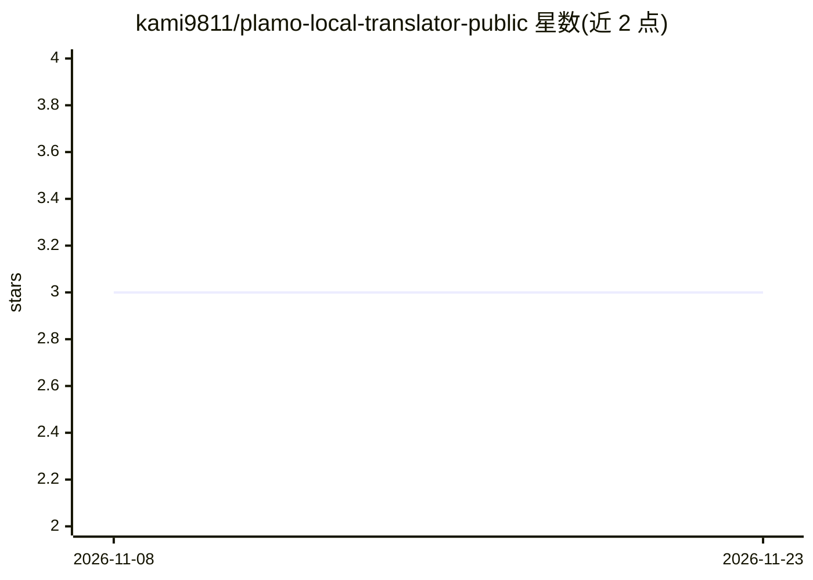

# kami9811/plamo-local-translator-public

⭐ 3 · Python · MIT · 推送 2026-11-06 · [GitHub](https://github.com/kami9811/plamo-local-translator-public) · 个人维护

**调用本地 PLaMo 模型的 Chrome 翻译扩展与论文初译工具**

由 Chrome 扩展与 PC 内本地翻译环境两部分组成：扩展将选中文本或整页英文传给本地运行的 PLaMo 3 Translate（2B/8B 可选），支持英↔日双向翻译，返回译文后可对照原文查看与编辑。针对论文初译场景提供文本/UTF-8 文件粘贴、逐段对齐、数学公式与代码保护、术语表指定，以及导出 Markdown/JSON 供后续审校。全部翻译在 PC 内处理，无云端翻译与遥测；PDF OCR 与版面还原则不支持。

## 筛选速览

| 维度 | 判定 | 备注 |
|---|---|---|
| AI 角色 | `ai-native` | 本体是模型或模型工具 |
| 许可风险 | `permissive` | MIT |
| 部署形态 | `None` |  |
| 模型依赖 | — | README 未给出锁定关系 |
| 硬件要求 | — | 无带数字的原话,不猜 |
| 安装摩擦 | `medium` | 含编译或系统依赖之一 |
| 成熟度 | `idea` | |

## 能力要点

- 本地运行 PLaMo 3 Translate（2B 约1.8GB / 8B 约5.3GB 权重），翻译不经云端
- 网页选句翻译与整页翻译、原文回退，英↔日双向切换
- 论文初译工作区：逐段对齐、公式/引用/代码保护、术语表、导出 Markdown/JSON
- 提供 Windows/Mac 起停辅助应用与连接密钥机制，配 llama.cpp 提示缓存

## 适用场景

- 在 Chrome 里选中文本或整页英日互译
- 翻译论文草稿初稿并保留公式与代码
- 按术语表统一译文用词并导出审校稿
- 敏感文档要求纯本地处理、不联网翻译

## 场景标签

`推理引擎` · 领域:训练与推理

## 证据(README 行号)

> L3: Chromeで選択した英文やページ全体を、日本語に翻訳するツールです。日本語から英語への翻訳や、論文原稿の下訳にも使えます。PLaMo 3 Translateを自分のPCで動かし、原文と訳文を見比べながら読んだり編集したりできます。
> L19: 使うものは、**Chrome拡張**と、**PC内でモデルを動かす翻訳環境**です。拡張が文章をPC内の翻訳環境へ渡し、返ってきた訳文を表示します。
> L87: 通常の翻訳はPC内の翻訳環境で処理します。クラウド翻訳・利用状況送信・自動更新の処理はありません。モデルや依存関係の取得、利用者がGitHub等の案内リンクを開く場合はインターネット通信があります。

## 星数曲线

2026-11-08 3 → 2026-11-23 3（+0）

---
*卡片 v1 · prompt 1.4 · 生成 2026-11-21 · 置信度 high · 依据 README sha `1108ac40aa58` · [字段定义](../../DATASET.md)*
