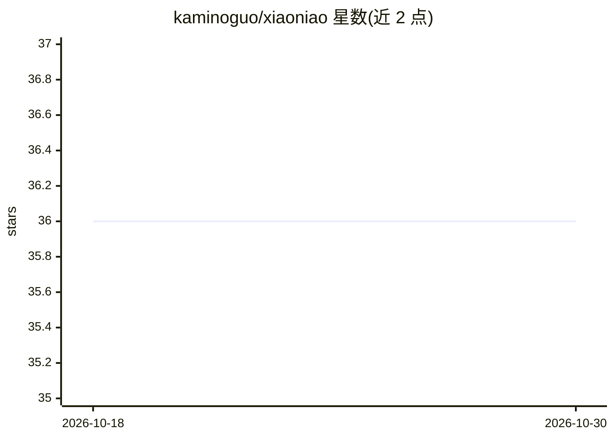

# kaminoguo/xiaoniao

⭐ 36 · Go · MIT · 推送 2025-12-10 · [GitHub](https://github.com/kaminoguo/xiaoniao) · 个人维护 · 中文 README

**边打字边翻译的轻量 AI 翻译工具（剪贴板监听）**

提供 Windows 桌面程序与 Chrome 扩展两种形态。桌面版通过监听剪贴板（Ctrl+X/Ctrl+C 触发）调用用户配置的 AI API（OpenAI、Anthropic 等，自动识别提供商）完成翻译并自动替换剪贴板内容，支持快捷键与提示词切换；提供 xiaoniao.exe 单文件下载（Windows 10/11 64 位）。Chrome 扩展支持内置 AI（Gemini Nano，设备端）、Gemini API 与试用密钥三种模式，可自定义翻译风格；Android 与 macOS 版开发中。

## 筛选速览

| 维度 | 判定 | 备注 |
|---|---|---|
| AI 角色 | `ai-native` | 本体是模型或模型工具 |
| 许可风险 | `permissive` | MIT |
| 部署形态 | `desktop` | 安装包/桌面程序 |
| 模型依赖 | — | README 未给出锁定关系 |
| 硬件要求 | — | 无带数字的原话,不猜 |
| 安装摩擦 | `low` | 无编译、无系统依赖或容器化 |
| 成熟度 | — | 结构信号不足 |

## 能力要点

- 剪贴板监听触发翻译，自动替换剪贴板内容
- 支持 OpenAI、Anthropic 等多家 API，系统自动识别提供商
- Chrome 扩展提供设备端 Gemini Nano 内置 AI 免费模式
- 可配置翻译风格预设与自定义风格

## 适用场景

- 打字或复制文本时即时获得 AI 翻译
- 通过自定义提示词指定翻译风格（如带颜文字的日语）
- 浏览器内复制即翻译并自动粘贴结果

## 场景标签

`AI 写作` · 领域:内容生成

## 证据(README 行号)

> L16: - Enter your API key (OpenAI, Anthropic, etc.)
> L31: - Ctrl+X to cut or Ctrl+C to copy text triggers translation
> L60: - Built-in AI: Free, private, on-device (Gemini Nano)

## 星数曲线

2026-10-18 36 → 2026-10-30 36（+0）

---
*卡片 v1 · prompt 1.4 · 生成 2026-10-25 · 置信度 high · 依据 README sha `7b7facb214b1` · [字段定义](../../DATASET.md)*
