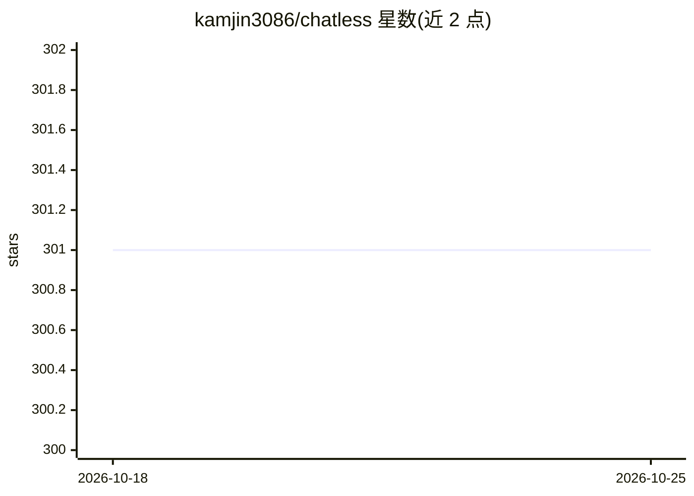

# kamjin3086/chatless

⭐ 301 · TypeScript · MIT · 推送 2026-10-24 · [GitHub](https://github.com/kamjin3086/chatless) · [官网](https://kamjin3086.github.io/chatless) · 个人维护 · 中文 README

**本地优先的桌面 AI 聊天客户端，数据全存本地**

基于 Tauri 2.0 与 Next.js 编写的桌面 AI 聊天客户端，面向终端用户。支持接入多种云端 AI 服务（OpenAI、Anthropic、DeepSeek 等）或本地模型（Ollama、LM Studio），提供 PDF/Word/Markdown 文档解析、本地向量检索 RAG 知识库、Vision 图片分析、MCP 协议集成、Prompt 管理与 WebDAV 提示词同步。数据完全存储在本地，不强制账号。安装包覆盖 Windows/macOS/Linux，部分 Windows 环境需另装 VC++ 运行库。

## 筛选速览

| 维度 | 判定 | 备注 |
|---|---|---|
| AI 角色 | `ai-native` | 本体是模型或模型工具 |
| 许可风险 | `permissive` | MIT |
| 部署形态 | `desktop` | 安装包/桌面程序 |
| 模型依赖 | local-ok | 支持本地模型 |
| 硬件要求 | — | 无带数字的原话,不猜 |
| 安装摩擦 | `low` | 无编译、无系统依赖或容器化 |
| 成熟度 | — | 结构信号不足 |

## 能力要点

- 多提供商接入：云端 API 与本地模型（Ollama/LM Studio）
- 本地 RAG 知识库，支持 PDF/Word/Markdown 解析与向量检索
- MCP 协议集成扩展第三方工具
- 数据本地存储，WebDAV 同步 Prompt（tombstone 策略）

## 适用场景

- 在桌面端用一个客户端对接多个云端或本地模型聊天
- 把自己的文档做成本地知识库做问答检索
- 离线或隐私敏感场景下配合 Ollama 使用本地模型

## 场景标签

`聊天机器人` `RAG` `文档问答` · 领域:对话与助手

## 证据(README 行号)

> L18: chatless 是一个桌面 AI 聊天客户端，支持接入多种云端 AI 服务（OpenAI、Anthropic、DeepSeek 等）或本地模型（Ollama、LM Studio）。数据完全存储在本地，支持文档解析与向量检索（RA
> L22: - 多 AI 提供商支持 - 云端服务与本地模型

## 星数曲线

2026-10-18 301 → 2026-10-25 301（+0）

---
*卡片 v1 · prompt 1.4 · 生成 2026-10-21 · 置信度 high · 依据 README sha `30ab88e1b95a` · [字段定义](../../DATASET.md)*
