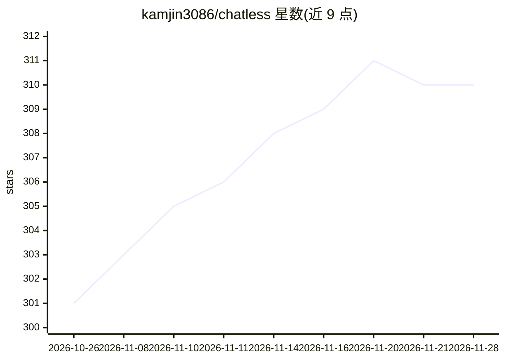

# kamjin3086/chatless

⭐ 310 · TypeScript · MIT · 推送 2026-11-27 · [GitHub](https://github.com/kamjin3086/chatless) · [官网](https://kamjin3086.github.io/chatless) · 个人维护 · 中文 README

**本地优先的桌面 AI 聊天客户端，支持多提供商与本地 RAG**

基于 Tauri 2.0 与 Next.js 构建的桌面 AI 聊天客户端，可接入 OpenAI、Anthropic、DeepSeek 等云端服务或 Ollama、LM Studio 本地模型，数据存储在本地。功能包括 PDF/Word/Markdown 文档解析、向量检索知识库（RAG）、Vision 模型图像分析、MCP 协议集成、Prompt 管理与 WebDAV 多设备同步。Windows/macOS/Linux 提供 GitHub Releases 安装包；Windows 部分环境需安装 VC++ 运行库。

## 筛选速览

| 维度 | 判定 | 备注 |
|---|---|---|
| AI 角色 | `ai-native` | 本体是模型或模型工具 |
| 许可风险 | `permissive` | MIT |
| 部署形态 | `desktop` | 安装包/桌面程序 |
| 模型依赖 | local-ok | 支持本地模型 |
| 硬件要求 | — | 无带数字的原话,不猜 |
| 安装摩擦 | `low` | 无编译、无系统依赖或容器化 |
| 成熟度 | — | 结构信号不足 |

## 能力要点

- 多 AI 提供商支持：云端服务与 Ollama、LM Studio 本地模型
- 本地 RAG 知识库：解析 PDF/Word/Markdown 并向量检索
- MCP 协议集成扩展第三方工具能力
- WebDAV 同步提示词，数据本地存储

## 适用场景

- 在本地桌面端与多家云端模型或本地模型对话
- 导入 PDF/Word 文档构建知识库辅助问答
- 离线或注重隐私的场景下使用本地模型聊天

## 场景标签

`聊天机器人` `文档问答` `文档解析` · 领域:对话与助手

## 证据(README 行号)

> L18: chatless 是一个桌面 AI 聊天客户端，支持接入多种云端 AI 服务（OpenAI、Anthropic、DeepSeek 等）或本地模型（Ollama、LM Studio）。数据完全存储在本地，支持文档解析与向量检索（RA
> L5:  基于 Tauri 2.0 与 Next.js 的本地优先 AI 聊天客户端

## 星数曲线

2026-10-26 301 → 2026-11-28 310（+9）

---
*卡片 v1 · prompt 1.4 · 生成 2026-11-25 · 置信度 high · 依据 README sha `e97371a2b3cf` · [字段定义](../../DATASET.md)*
