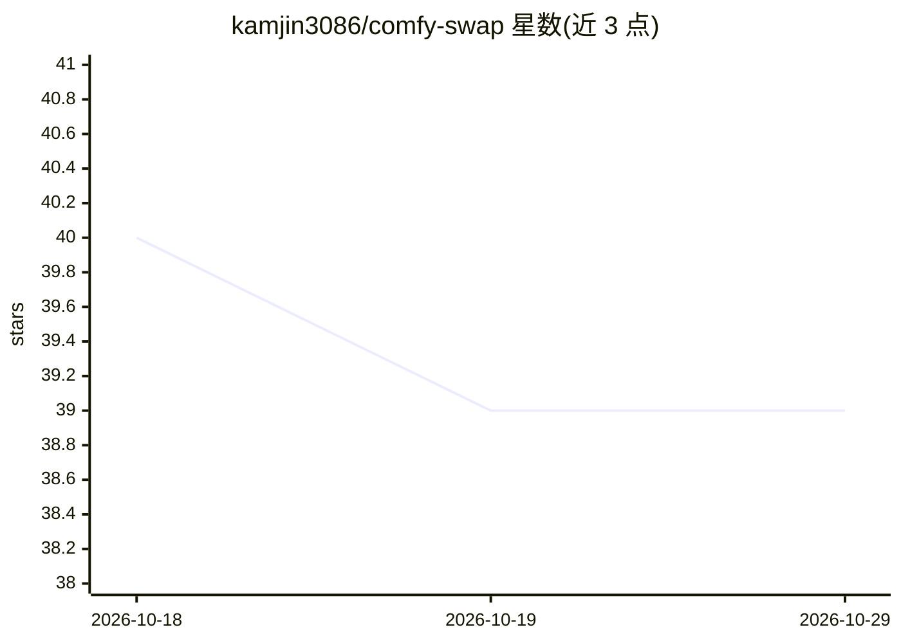

# kamjin3086/comfy-swap

⭐ 39 · Go · MIT · 推送 2026-03-30 · [GitHub](https://github.com/kamjin3086/comfy-swap) · 个人维护 · 中文 README

**把 ComfyUI 工作流暴露为 REST API 与 CLI 的桥接工具**

用 Go 编写的 ComfyUI 工作流桥接层：通过 ComfyUI 插件的导出对话框把可视化工作流注册为可调用 API 端点，以参数映射将内部节点字段转为命名参数（一个参数可联动多个节点），REST API 与 CLI 共享同一接口；提供 Web Playground 测试、请求日志、图片上传下载、配置备份恢复。面向需要将图像生成工作流集成到脚本、自动化或 AI agent 的开发者。不管理 ComfyUI 安装与自定义节点，需已运行的 ComfyUI 实例。另提供可被 Claude Code、Cursor 等 agent 安装的 skill。

## 筛选速览

| 维度 | 判定 | 备注 |
|---|---|---|
| AI 角色 | `ai-ecosystem` | LLM/agent 周边工具 |
| 许可风险 | `permissive` | MIT |
| 部署形态 | `desktop` | 安装包/桌面程序 |
| 模型依赖 | — | README 未给出锁定关系 |
| 硬件要求 | — | 无带数字的原话,不猜 |
| 安装摩擦 | `low` | 无编译、无系统依赖或容器化 |
| 成熟度 | — | 结构信号不足 |

## 能力要点

- ComfyUI 工作流导出为 REST API 端点与 CLI 命令，双接口共享参数
- 参数映射将友好命名映射到内部节点字段，一个参数可更新多个节点
- Web Playground 交互测试、请求日志过滤、配置备份/恢复
- 提供 npx skills 安装的 AI agent 技能包

## 适用场景

- 把 ComfyUI 画布上的工作流接入现有应用的 REST 调用
- 让 AI agent 通过 CLI 自动执行图像生成工作流
- 用统一命名参数隔离工作流内部改动对集成方的影响

## 场景标签

`图像生成` · 领域:内容生成

## 证据(README 行号)

> L8: **Comfy-Swap** exposes ComfyUI workflows as stable, production-ready APIs. It bridges the gap between ComfyUI's visu
> L73: - **Workflow → API**: Export any ComfyUI workflow as a callable API endpoint

## 星数曲线

2026-10-18 40 → 2026-10-29 39（-1）

---
*卡片 v1 · prompt 1.4 · 生成 2026-10-25 · 置信度 high · 依据 README sha `2649f9ed27a8` · [字段定义](../../DATASET.md)*
