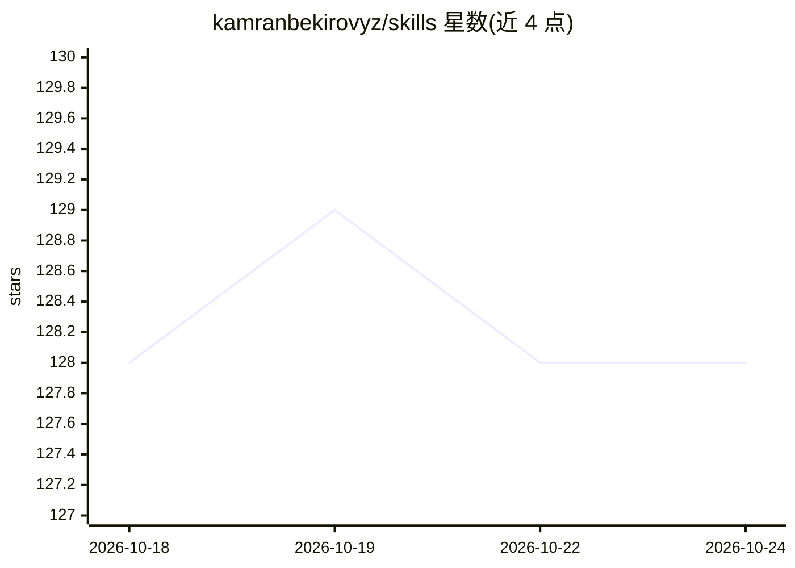

# kamranbekirovyz/skills

⭐ 128 · 推送 2026-08-02 · [GitHub](https://github.com/kamranbekirovyz/skills) · [官网](https://flutterskills.md) · 个人维护

**面向 AI 编程 agent 的 Flutter 应用开发技能包**

提供用于 AI 编程 agent 的技能（skills）合集：flutter-improve-design 审查 Flutter 代码、找出 UI/UX 改进点并为用户选中的项生成实施计划，建议用较强的模型做审查与规划、用较便宜的模型执行计划；flutter-design-taste 标注为 Coming soon。技能通过 npx skills add 命令安装，随后在 Flutter 项目中以 /flutter-improve-design 斜杠命令调用。作者自述基于构建 80+ 个 Flutter 应用的经验整理。

## 筛选速览

| 维度 | 判定 | 备注 |
|---|---|---|
| AI 角色 | `ai-knowledge` | 知识聚合/清单类 |
| 许可风险 | `none` | — |
| 部署形态 | `library` | 以包/库形式分发 |
| 模型依赖 | — | README 未给出锁定关系 |
| 硬件要求 | — | 无带数字的原话,不猜 |
| 安装摩擦 | `low` | 无编译、无系统依赖或容器化 |
| 成熟度 | — | 结构信号不足 |

## 能力要点

- flutter-improve-design：代码审查→UI/UX 改进点→生成实施计划
- 建议审查/规划与执行使用不同档位模型
- 通过 npx skills add 安装、项目内斜杠命令调用

## 适用场景

- 让 AI 编程 agent 在开发 Flutter 应用时遵循 UI/UX 设计决策
- 对现有 Flutter 代码做 UI/UX 审查并生成改进计划

## 场景标签

`代码审查` · 领域:编码与开发

## 证据(README 行号)

> L3: Skills for building beautiful Flutter apps with AI coding agents.
> L11: Reviews Flutter code to find UI/UX improvements and writes an implementation plan for the ones you pick. Use the be

## 星数曲线

2026-10-18 128 → 2026-10-24 128（+0）

---
*卡片 v1 · prompt 1.4 · 生成 2026-10-22 · 置信度 high · 依据 README sha `1ade5ea181f5` · [字段定义](../../DATASET.md)*
