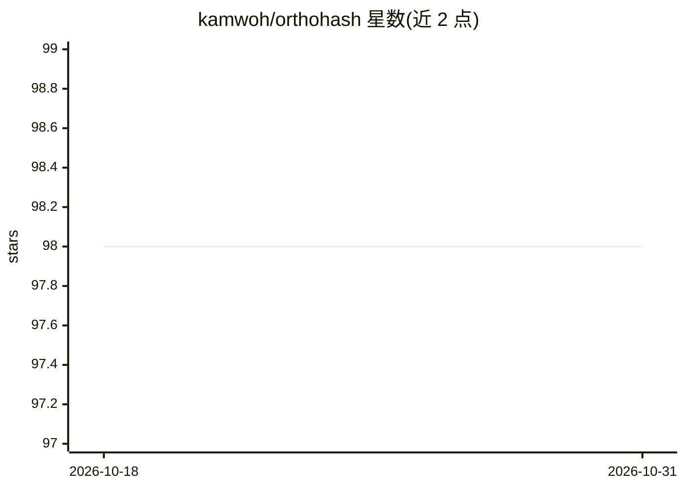

# kamwoh/orthohash

⭐ 98 · Python · BSD-3-Clause · 推送 2026-02-27 · [GitHub](https://github.com/kamwoh/orthohash) · 组织维护

**NeurIPS 2021 深度哈希论文官方实现：单余弦相似度目标做图像检索**

论文《One Loss for All: Deep Hashing with a Single Cosine Similarity based Learning Objective》(NeurIPS 2021) 的官方 PyTorch 实现：用单一学习目标最大化连续编码与二值正交编码间的余弦相似度，配合 BN 层保证编码均衡、标签平滑处理多标签交叉熵。支持 CIFAR-10/ImageNet/NUS-WIDE/MS-COCO 类别级检索与 GLDv2/ROxf/RPar 实例级检索实验，提供训练/测试命令与数据集准备方式。作者后续将 embedding 加载与评测迁移至通用框架 CISiP-FIRe。

## 筛选速览

| 维度 | 判定 | 备注 |
|---|---|---|
| AI 角色 | `ai-native` | 本体是模型或模型工具 |
| 许可风险 | `permissive` | BSD-3-Clause |
| 部署形态 | `None` |  |
| 模型依赖 | — | README 未给出锁定关系 |
| 硬件要求 | — | 无带数字的原话,不猜 |
| 安装摩擦 | `low` | 无编译、无系统依赖或容器化 |
| 成熟度 | — | 结构信号不足 |

## 能力要点

- 单一余弦相似度学习目标替代多损失组合
- 支持类别级（CIFAR-10/ImageNet/NUS-WIDE/MS-COCO）与实例级（GLDv2/ROxf/RPar）检索实验
- README 提供调参技巧（backbone 学习率、cosine margin、codebook 方法等）
- CIFAR-10 数据集首次运行自动生成

## 适用场景

- 复现论文中的深度哈希检索实验
- 以 OrthoHash 为基线做图像检索研究
- 参考其单目标训练机制开发哈希检索方法

## 场景标签

 · 领域:计算机视觉/图像检索

## 证据(README 行号)

> L5: ### Official pytorch implementation of the paper: "One Loss for All: Deep Hashing with a Single Cosine Similarity ba
> L17: This paper proposes a novel deep hashing model with only a single learning objective which is a simplification from

## 星数曲线

2026-10-18 98 → 2026-10-31 98（+0）

---
*卡片 v1 · prompt 1.4 · 生成 2026-10-23 · 置信度 high · 依据 README sha `6f73e97dca3b` · [字段定义](../../DATASET.md)*
