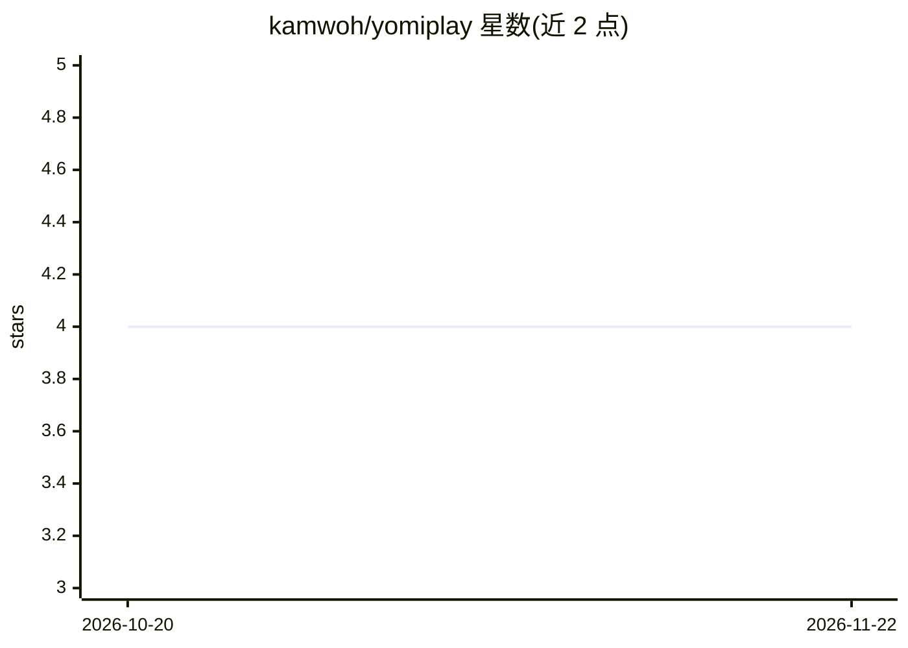

# kamwoh/yomiplay

⭐ 4 · Python · MIT · 推送 2026-10-18 · [GitHub](https://github.com/kamwoh/yomiplay) · 个人维护 · 中文 README

**边玩 PS1 游戏边学日语：浏览器模拟器配 AI 解读屏幕文本**

在浏览器中运行的 PS1 模拟器，基于 libretro 架构，核心机制是把屏幕截图发送给模型，生成学习卡片（原文转录、读音、翻译、语法注释），并在游戏画面上叠加翻译文本；已读词汇计入个人词表。用户需自备 libretro PS1 核心、BIOS 与游戏文件（项目不含），并以 Claude Code CLI 作为模型后端。支持解释档案定制目标语言与难度、按游戏序列号配置文本框区域。通过 uv 管理 Python 依赖，在 WSL2/Linux 运行。

## 筛选速览

| 维度 | 判定 | 备注 |
|---|---|---|
| AI 角色 | `ai-native` | 本体是模型或模型工具 |
| 许可风险 | `permissive` | MIT |
| 部署形态 | `None` |  |
| 模型依赖 | locked-api |  |
| 硬件要求 | — | 无带数字的原话,不猜 |
| 安装摩擦 | `low` | 无编译、无系统依赖或容器化 |
| 成熟度 | — | 结构信号不足 |

## 能力要点

- 屏幕截图→学习卡片（转录/读音/翻译/注释），翻译可叠加显示在游戏画面
- 个人词表统计已读词汇
- 解释档案（profiles）可定制目标语言、水平与风格
- 同一核心预留 Gymnasium RL 环境与基准测试接口（规划中）

## 适用场景

- 玩日语 PS1 游戏时查看屏幕文本的读音与翻译
- 通过游戏对话积累个人词汇表
- 用游戏文本框裁剪配置提高模型读取准确性

## 场景标签

 · 领域:教育/游戏工具

## 证据(README 行号)

> L5: A PS1 emulator with a language model beside the game. Version 1 is a **companion for learning Japanese while you pla
> L16: - Claude Code CLI, logged in (used as the model backend; no API key needed)
> L33: Ask about the screen to receive study cards with transcriptions, readings, translations, and notes. The translation

## 星数曲线

2026-10-20 4 → 2026-11-22 4（+0）

---
*卡片 v1 · prompt 1.4 · 生成 2026-11-21 · 置信度 high · 依据 README sha `c6471424cf5a` · [字段定义](../../DATASET.md)*
