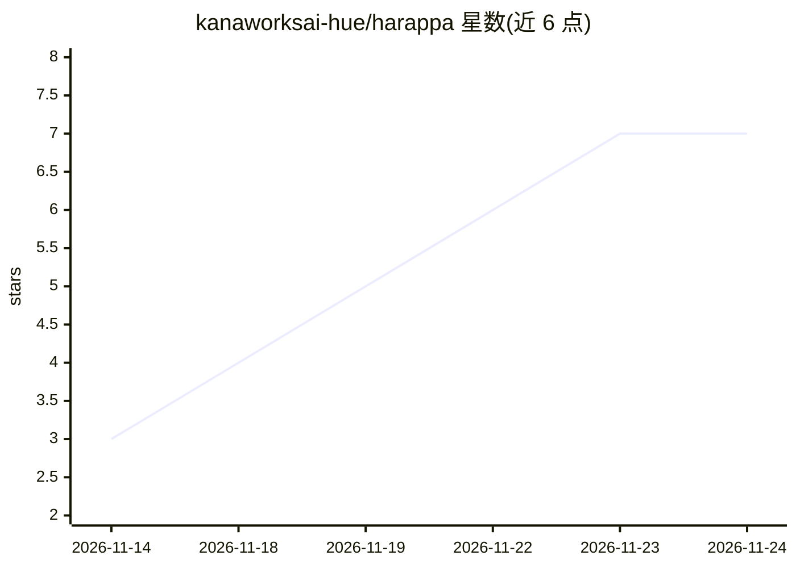

# kanaworksai-hue/harappa

⭐ 8 · Python · GPL-3.0 · 推送 2026-11-17 · [GitHub](https://github.com/kanaworksai-hue/harappa) · [官网](https://x.com/KanaWorks_AI) · 组织维护 · 中文 README

**一键生成动漫风草原场景的免费 Blender 插件**

面向 Blender 5.0+（EEVEE 渲染）的免费开源插件：一键从裸地形生成动漫背景风格的草原、花、树、天空与积云，支持 6 种季节 × 4 种画风组合、9 种树形、四层笔刷绘制（草/花/草高/颜色）、角色避让、水面（池/溪/瀑布）与天气（雨/虹/萤火虫）。核心实现为几何节点实例散布与 Shader to RGB 三段赛璐璐着色。另可通过 Claude Code、Codex 等桌面 AI Agent 按 AGENTS.md 完成安装与操作。以 zip 发行版安装。

## 筛选速览

| 维度 | 判定 | 备注 |
|---|---|---|
| AI 角色 | `ai-enhanced` | 去掉 AI 部分产品仍成立 |
| 许可风险 | `viral` | GPL-3.0 |
| 部署形态 | `None` |  |
| 模型依赖 | — | README 未给出锁定关系 |
| 硬件要求 | — | 无带数字的原话,不猜 |
| 安装摩擦 | `low` | 无编译、无系统依赖或容器化 |
| 成熟度 | — | 结构信号不足 |

## 能力要点

- 一键生成草原+花+天空+云+太阳+相机，6 季节 × 4 画风组合
- 四层笔刷绘制道路/花坛/草高/色彩，草可自动避让角色
- 水面与天气系统：池/溪/瀑布/岩，雨/岚/虹/萤火虫
- 支持让桌面 AI Agent（Claude Code 等）按 AGENTS.md 安装并操作插件

## 适用场景

- 为动漫风格背景图快速生成草原、树木与天空场景
- 为角色模型铺设会自动避让的草地与花坛
- 制作带池塘、瀑布、雨虹等元素的动画场景

## 场景标签

 · 领域:3D内容创作/动漫美术工具

## 证据(README 行号)

> L18: **Harappa（原っぱ）** は、アニメ背景のような草原・花・空をボタンひとつで、木ももうひとつのボタンで作れる無料の Blender アドオンです。草は一本一本生えて風にそよぎ、光と影は大きな「草のかたまり」で塗り分けられま
> L127: ### AI エージェントに頼む（おすすめ）
> L145: **必要なもの：** Blender 5.0 以降（Blender 5.2 LTS と 5.3 で動作確認済み）、レンダーエンジンは EEVEE。

## 星数曲线

2026-11-14 3 → 2026-11-24 7（+4）

---
*卡片 v1 · prompt 1.4 · 生成 2026-11-21 · 置信度 high · 依据 README sha `61bf9ce1ef6f` · [字段定义](../../DATASET.md)*
