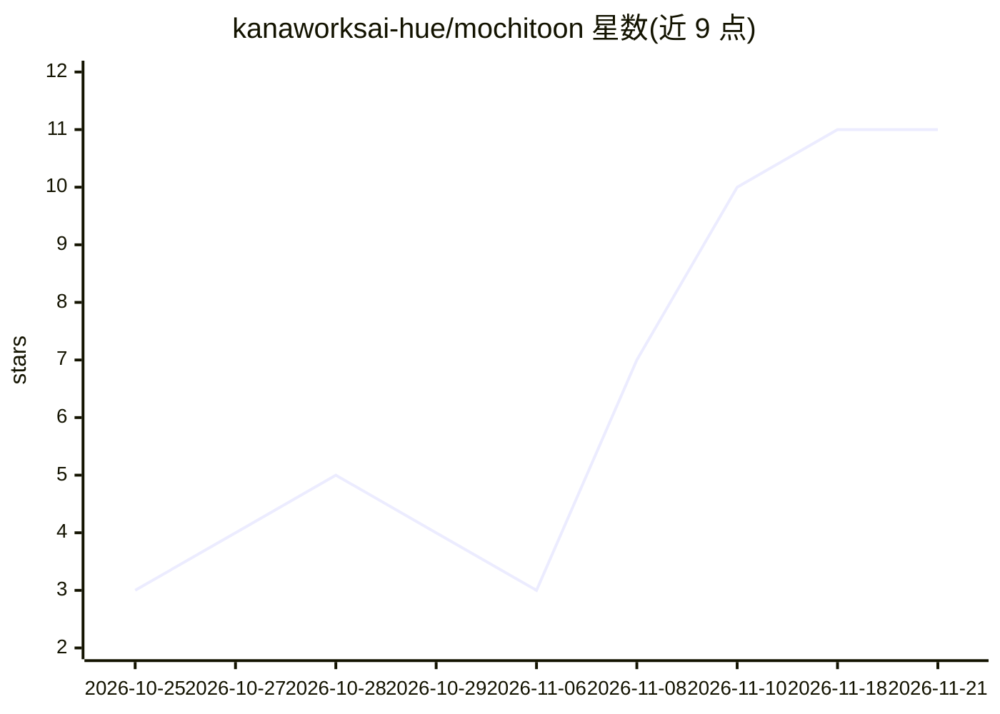

# kanaworksai-hue/mochitoon

⭐ 11 · Python · GPL-3.0 · 推送 2026-11-17 · [GitHub](https://github.com/kanaworksai-hue/mochitoon) · 组织维护 · 中文 README

**让 AI 代理一键安装的 Blender 卡通渲染插件**

MochiToon 是一款面向 Blender 4.2+（EEVEE 渲染器）的免费开源插件，将 3D 模型转换为漫画风格：提供彩色阴影、6 种高光形状（网点/撒花）、斜线、边缘光与轮廓线共 5 个图层，配 13 种调色板，支持一键场景设置。特色在于可由 AI 代理（Claude Code、Codex 等）按 AGENTS.md 指引完成下载、安装与应用；也支持手动通过扩展界面安装 zip 包。不兼容 Cycles 与正交相机。

## 筛选速览

| 维度 | 判定 | 备注 |
|---|---|---|
| AI 角色 | `ai-enhanced` | 去掉 AI 部分产品仍成立 |
| 许可风险 | `viral` | GPL-3.0 |
| 部署形态 | `None` |  |
| 模型依赖 | — | README 未给出锁定关系 |
| 硬件要求 | — | 无带数字的原话,不猜 |
| 安装摩擦 | `low` | 无编译、无系统依赖或容器化 |
| 成熟度 | — | 结构信号不足 |

## 能力要点

- 5 层效果：彩色阴影、高光形状、斜线、边缘光、轮廓线
- 6 种高光形状与 13 种调色板可组合
- AI 代理按 AGENTS.md 自动完成安装与应用
- 应用时默认另名保存 .blend，不覆盖原文件

## 适用场景

- 把角色、道具、Logo、背景等 3D 模型转成漫画风格渲染
- 通过对话让 AI 代理调整阴影、高光、轮廓线效果
- Blender 中快速设置卡通渲染场景

## 场景标签

 · 领域:3D 图形/创意工具

## 证据(README 行号)

> L17: **MochiToon** は、Blender の 3D モデルをかわいいマンガ風（トゥーン調）に変える、無料の Blender アドオンです。影に色をのせ、光の当たる所にハートや星をちらし、斜線・縁の光・輪郭線を重ねて、印刷マン
> L70: エージェントは AGENTS.md の手順に従って、最新リリースのダウンロード、Blender へのインストール、適用、プレビューの書き出しまでを行います。.blend ファイルに適用するときは、頼まれない限り元のファイルを上書き
> L92: **必要なもの：** Blender 4.2 以降（Blender 5.1 と 5.2 で動作確認済み）、レンダーエンジンは EEVEE。

## 星数曲线

2026-10-25 3 → 2026-11-21 11（+8）

---
*卡片 v1 · prompt 1.4 · 生成 2026-11-18 · 置信度 high · 依据 README sha `51b0897897d8` · [字段定义](../../DATASET.md)*
