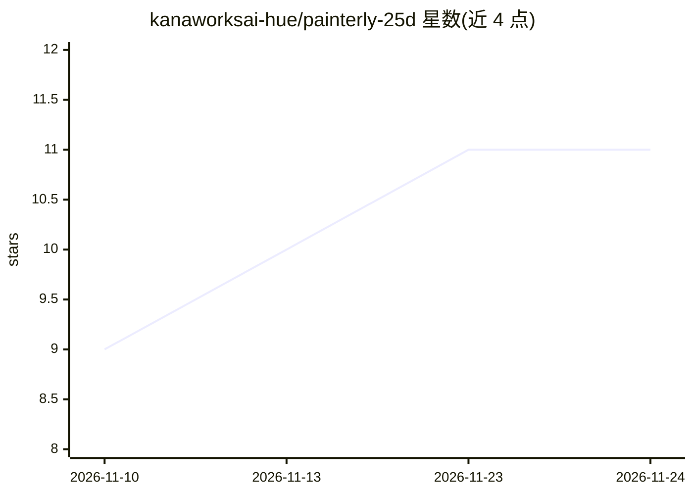

# kanaworksai-hue/painterly-25d

⭐ 11 · Python · GPL-3.0 · 推送 2026-11-17 · [GitHub](https://github.com/kanaworksai-hue/painterly-25d) · [官网](https://x.com/KanaWorks_AI) · 组织维护

**一键把 Blender 3D 场景转成手绘 2.5D 画面效果的免费插件**

Blender 5.0+ 扩展插件，通过 EEVEE 渲染管线将任意场景转为手绘风格：在明暗交界处叠加笔触的卡通着色、反转壳轮廓线（2 帧抖动）、合成器后处理（桑原滤镜、晕染、纸纹等）。提供 6 种画材（油画/水彩/蜡笔/色铅笔/动画赛璐璐等）与随机 Shuffle 变体，5 种配色预设，支持撤销还原与按物体覆盖参数。可由 AI agent 按 AGENTS.md 指示完成安装与调用，也可手动安装；不支持 Cycles。

## 筛选速览

| 维度 | 判定 | 备注 |
|---|---|---|
| AI 角色 | `ai-enhanced` | 去掉 AI 部分产品仍成立 |
| 许可风险 | `viral` | GPL-3.0 |
| 部署形态 | `None` |  |
| 模型依赖 | — | README 未给出锁定关系 |
| 硬件要求 | — | 无带数字的原话,不猜 |
| 安装摩擦 | `low` | 无编译、无系统依赖或容器化 |
| 成熟度 | — | 结构信号不足 |

## 能力要点

- 一键完成 EEVEE、材质、轮廓线、合成器的整体配置
- 6 种画材与 Shuffle 随机变体（可凭编号复现）
- 自动为无材质/无灯光对象补建材质与主光，保持顶点色
- 支持日/英/简中界面，可撤销还原原始材质与合成器

## 适用场景

- 把 3D 场景渲染成油画、水彩等手绘风格插画
- 动画制作中需要手绘抖动轮廓线的 NPR 渲染
- 通过 Claude Code 等 agent 用一句话完成安装与风格调整

## 场景标签

 · 领域:3D 图形/创意工具

## 证据(README 行号)

> L18: **Painterly 2.5D** は、Blender のシーンをボタンひとつで「手描きの絵」に変える、無料の Blender アドオンです。光と影の境目にだけ筆のタッチを入れるトゥーン、2コマ打ちでゆらゆら揺れる手描きの輪郭線
> L30:  AIにおまかせ エージェントに一言。インストール、適用、プレビューまで自動
> L79: ### AI エージェントに頼む（おすすめ）

## 星数曲线

2026-11-10 9 → 2026-11-24 11（+2）

---
*卡片 v1 · prompt 1.4 · 生成 2026-11-19 · 置信度 high · 依据 README sha `de7d8c8f487b` · [字段定义](../../DATASET.md)*
