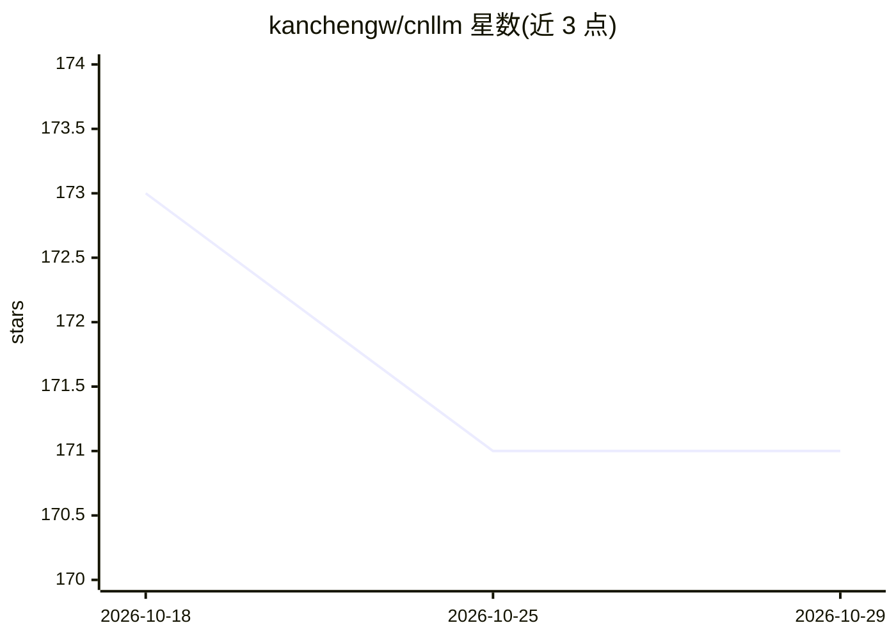

# kanchengw/cnllm

⭐ 171 · Python · Apache-2.0 · 推送 2026-06-15 · [GitHub](https://github.com/kanchengw/cnllm) · 个人维护 · 中文 README

**中文大模型统一 OpenAI 兼容接口的 Python 适配工具包**

CNLLM 是面向开发者的 Python 工具包，为 DeepSeek、KIMI、豆包、智谱 GLM、千问、百度千帆、MiniMax、阶跃星辰、腾讯混元等中文大模型提供统一的 OpenAI 兼容接口层，返回 OpenAI API 标准响应，可在 langchain、LlamaIndex、AutoGen、Haystack、DeepEval 等框架中使用。功能包括参数验证与 drop_params 控制、流式响应的 repr() 生命周期监测与 still/think/tools 增量自动累积、批量调用（单请求独立配置、实时进度统计、失败策略、自适应调度与池化算法）以及 Embeddings 单条/批量调用。通过 pip 安装，另提供 Claude Skills 规范的 Agent Skill 安装方式。

## 筛选速览

| 维度 | 判定 | 备注 |
|---|---|---|
| AI 角色 | `ai-ecosystem` | LLM/agent 周边工具 |
| 许可风险 | `permissive` | Apache-2.0 |
| 部署形态 | `library` | 以包/库形式分发 |
| 模型依赖 | locked-api |  |
| 硬件要求 | — | 无带数字的原话,不猜 |
| 安装摩擦 | `low` | 无编译、无系统依赖或容器化 |
| 成熟度 | — | 结构信号不足 |

## 能力要点

- 统一接口调用多家中文大模型，返回 OpenAI API 标准响应
- 流式响应增量字段（still/think/tools）自动累积与实时视图
- 批量调用支持单请求独立配置、实时统计、自适应调度与 fallback 模型
- 厂商原生参数验证与 drop_params 行为控制

## 适用场景

- 在 langchain/LlamaIndex/AutoGen 等框架中接入中文大模型
- 多模型协作场景下统一接口与参数调用
- 批量推理任务中做并发控制、进度统计与失败重试
- 中文文本的 Embeddings 批量生成

## 场景标签

`模型网关` · 领域:Agent 开发

## 证据(README 行号)

> L13: CNLLM Python 工具包为各类中文大语言模型提供**统一的 OpenAI 兼容接口层**，并配套一系列**增强工具**，大幅简化大模型开发流程。
> L15: 通过 CNLLM，开发者可以无障碍地在 OpenAI 生态内的 langchain、LlamaIndex、AutoGen、Haystack、DeepEval 等主流大模型应用框架中使用中文大模型；尤其在需要多模型协作的开发和应用场

## 星数曲线

2026-10-18 173 → 2026-10-29 171（-2）

---
*卡片 v1 · prompt 1.4 · 生成 2026-10-22 · 置信度 high · 依据 README sha `f00496b755fc` · [字段定义](../../DATASET.md)*
