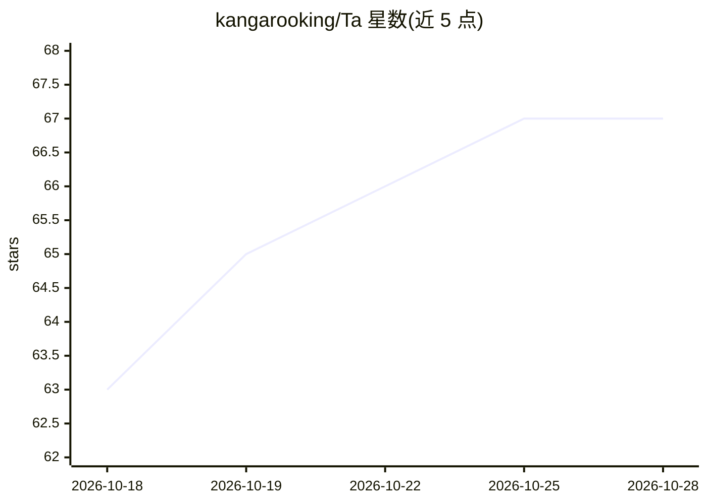

# kangarooking/Ta

⭐ 67 · C# · MIT · 推送 2026-09-25 · [GitHub](https://github.com/kangarooking/Ta) · 个人维护 · 中文 README

**macOS AI 原生截图工具：截图、OCR、识图、翻译、长截图、钉图与标注**

基于 Swift/SwiftUI 与 AppKit 的原生 macOS 截图应用，把截图、OCR 取字、多模态 AI 识图、翻译、滚动长截图、原位标注与钉图集中在同一条操作链路。OCR 支持 Apple Vision 本地识别、PaddleOCR 离线增强包与用户自部署的 DeepSeek-OCR-2；多模态支持 OpenAI-compatible、Azure、Claude、Gemini 协议。API Key 存于 macOS Keychain，默认本地处理。另提供 ta CLI 与 Agent Skill 供 Agent 调用。Windows 预览版（.NET 8 移植）可下载试用。AI 美化功能开发中。

## 筛选速览

| 维度 | 判定 | 备注 |
|---|---|---|
| AI 角色 | `ai-native` | 本体是模型或模型工具 |
| 许可风险 | `permissive` | MIT |
| 部署形态 | `desktop` | 安装包/桌面程序 |
| 模型依赖 | — | README 未给出锁定关系 |
| 硬件要求 | — | 无带数字的原话,不猜 |
| 安装摩擦 | `medium` | 含编译或系统依赖之一 |
| 成熟度 | `idea` | |

## 能力要点

- 截图、OCR、AI 识图、翻译、长截图、钉图、标注集中于一条链路
- OCR 可按速度/结构/隐私在 Apple Vision、PaddleOCR 与远程模型间切换
- API Key 仅存 macOS Keychain，低置信度上传需用户确认
- 提供 ta CLI 与 Agent Skill 作为 Agent 视觉输入层

## 适用场景

- 截图后直接取字、翻译、标注或钉图，减少多应用切换
- 捕获浏览器或聊天窗口的滚动长截图并自动拼接
- 让 Agent 通过截图读取并理解屏幕内容
- 公众号/文档场景的截图处理（AI 美化开发中）

## 场景标签

`OCR` `多模态` `图像视频处理` · 领域:感知与多模态

## 证据(README 行号)

> L13: **AI 原生截图工具：截图、取字、AI 识图、翻译、长截图、钉图与标注，一步完成。**
> L46: - **读出来**：使用本地 OCR 或多模态模型提取文字、表格、公式与代码；
> L107: - **多模态模型**：支持 OpenAI-compatible、Azure OpenAI、Anthropic Claude 与 Google Gemini 协议。

## 星数曲线

2026-10-18 63 → 2026-10-28 67（+4）

---
*卡片 v1 · prompt 1.4 · 生成 2026-10-24 · 置信度 high · 依据 README sha `0af407dc7608` · [字段定义](../../DATASET.md)*
