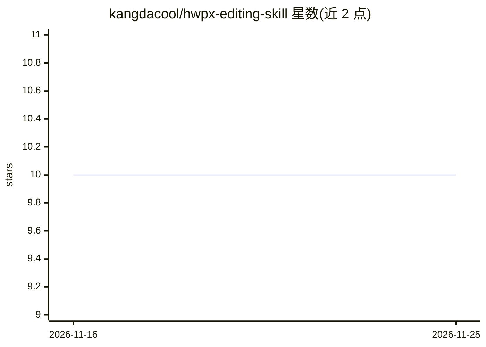

# kangdacool/hwpx-editing-skill

⭐ 10 · Python · MIT · 推送 2026-10-12 · [GitHub](https://github.com/kangdacool/hwpx-editing-skill) · 个人维护

**教 LLM agent 无损编辑韩文 .hwpx 文件的技能包**

面向 AI 编码代理的可移植 Agent Skill，将验证过的 HWPML 编辑规则与 Python 工具封装在一起，使 Claude Code、Codex、Cursor、Gemini CLI 等代理编辑韩文 HWPX 文件时不损坏文件。核心机制包括 raw-preserving 重压缩器（repack_preserve，空操作输出与源文件字节一致）、PostToolUse 钩子自动结构检查（hwpx_guard.py，不占模型上下文）、以及渲染级排版缺陷审计。依赖仅 lxml，渲染审计需安装韩文版 Hangul。非开发者可通过 claude.ai 上传技能 zip 使用。

## 筛选速览

| 维度 | 判定 | 备注 |
|---|---|---|
| AI 角色 | `ai-ecosystem` | LLM/agent 周边工具 |
| 许可风险 | `permissive` | MIT |
| 部署形态 | `library` | 以包/库形式分发 |
| 模型依赖 | — | README 未给出锁定关系 |
| 硬件要求 | — | 无带数字的原话,不猜 |
| 安装摩擦 | `low` | 无编译、无系统依赖或容器化 |
| 成熟度 | — | 结构信号不足 |

## 能力要点

- raw-preserving 重压缩器空操作输出与源文件字节一致（selftest.py 验证）
- PostToolUse 钩子自动对修改过的 .hwpx 做结构硬检查，零 token 开销
- 渲染审计捕捉仅 Hangul 打开才暴露的排版缺陷（空页、TOC 页码不符等）
- SKILL.md 格式兼容 Claude Code/Codex/Cursor/Gemini CLI 等多个 agent

## 适用场景

- 让 Claude Code 等代理编辑现有 .hwpx 报告/论文而不损坏文件
- 在 claude.ai 上传技能后用自然语言修改 HWPX 文档
- 对 python-hwpx 编辑后的文件做结构与渲染审计

## 场景标签

 · 领域:开发工具/agent 技能

## 证据(README 行号)

> L5: 검증된 HWPML 편집 규칙과 실제로 돌아가는 Python 도구를 하나로 묶었습니다. Claude Code · Codex · Cursor · Gemini CLI 등에서 그대로 씁니다.
> L92: 그대로 사용자에게 갑니다. 플러그인으로 설치하면 `hwpx_guard.py`가 **PostToolUse 훅**으로
> L128: /plugin marketplace add kangdacool/hwpx-editing-skill

## 星数曲线

2026-11-16 10 → 2026-11-25 10（+0）

---
*卡片 v1 · prompt 1.4 · 生成 2026-11-19 · 置信度 mid · 依据 README sha `9ce32ce8407f` · [字段定义](../../DATASET.md)*
