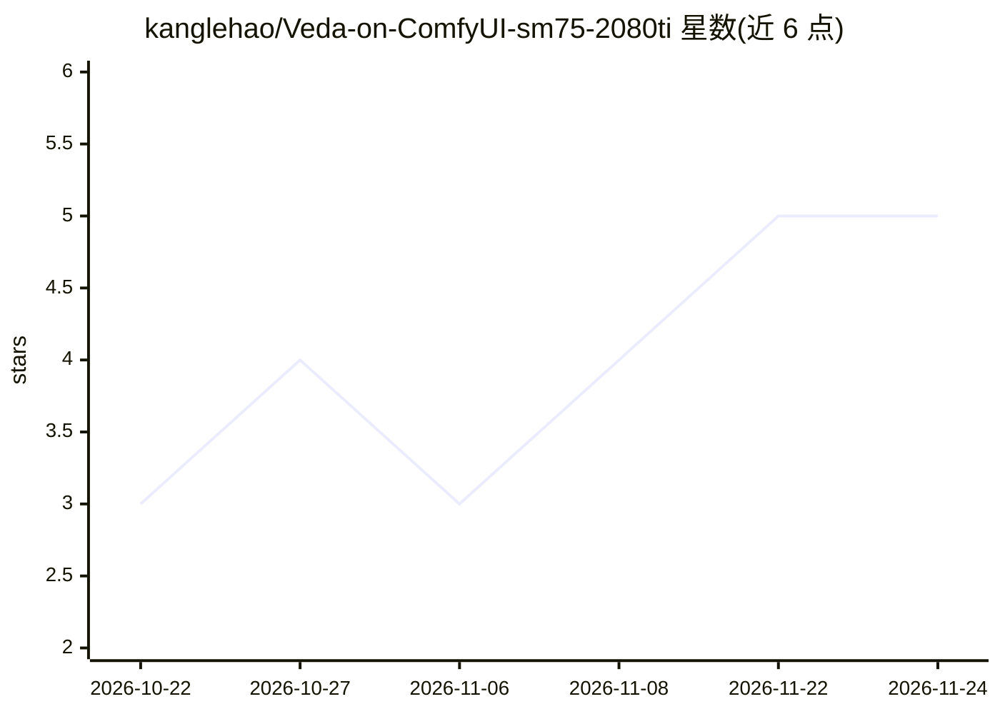

# kanglehao/Veda-on-ComfyUI-sm75-2080ti

⭐ 5 · Python · MIT · 推送 2026-10-31 · [GitHub](https://github.com/kanglehao/Veda-on-ComfyUI-sm75-2080ti) · 个人维护 · 中文 README

**让 RTX 2080 Ti 等 sm_75 显卡在 ComfyUI 中运行 Veda 稀疏注意力加速**

ComfyUI 自定义节点 fork，在上游 Veda（仅支持 SM80+ 的 Triton 路径）基础上为 NVIDIA Turing（sm_75）手写 int8 CUDA 内核，提供 tensor-core mma 与 DP4A 两条量化路径，并修正跨平台编译标志使其可在 Linux/Windows 构建。用于加速 MiniMax-H3 视频生成采样，作者在 2080 Ti 上实测 768x768x124 帧 4.16x、512x512 1.83x 加速。限制：不兼容 ComfyUI 张量并行多 GPU 模式，需单卡运行；内核首次使用时 JIT 编译，需安装 ninja 并配置匹配 torch 的 CUDA toolkit。

## 筛选速览

| 维度 | 判定 | 备注 |
|---|---|---|
| AI 角色 | `ai-native` | 本体是模型或模型工具 |
| 许可风险 | `permissive` | MIT |
| 部署形态 | `library` | 以包/库形式分发 |
| 模型依赖 | — | README 未给出锁定关系 |
| 硬件要求 | — | 无带数字的原话,不猜 |
| 安装摩擦 | `high` | 编译与系统依赖俱全 |
| 成熟度 | — | 结构信号不足 |

## 能力要点

- 为 sm_75 手写 CUDA 稀疏注意力内核（int8 mma 与 DP4A 两条路径）
- 以单个节点插入 MODEL 连线，可 Ctrl+B 旁路对比
- 跨平台编译标志修正，支持 Linux 与 Windows 构建
- 节点输出 attention 实算百分比与 tile 计划提示

## 适用场景

- 在 RTX 2080 Ti / GTX 16 系显卡上加速 MiniMax-H3 视频生成
- ComfyUI 中对比稀疏注意力开与关的生成速度
- 为 sm_75 设备扩展原本仅支持 SM80+ 的上游项目

## 场景标签

`视频生成` · 领域:内容生成

## 证据(README 行号)

> L3: # Veda Sparse Attention for ComfyUI — with Turing / RTX 20-series (sm_75) support
> L5: **Enables Veda's learned sparse attention on NVIDIA Turing GPUs (RTX 2080 Ti,
> L20: 1. **A CUDA sparse-attention kernel for `sm_75`** (compute capability 7.5).

## 星数曲线

2026-10-22 3 → 2026-11-24 5（+2）

---
*卡片 v1 · prompt 1.4 · 生成 2026-11-21 · 置信度 mid · 依据 README sha `345bb68c7faf` · [字段定义](../../DATASET.md)*
