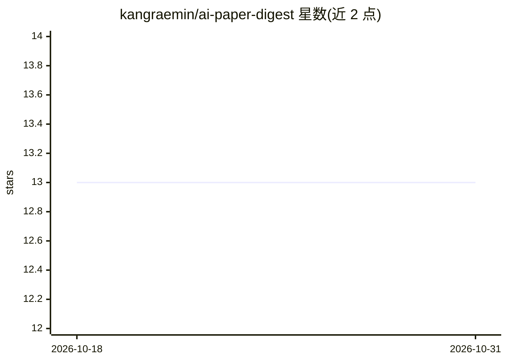

# kangraemin/ai-paper-digest

⭐ 13 · TypeScript · 推送 2026-10-30 · [GitHub](https://github.com/kangraemin/ai-paper-digest) · [官网](https://ai-paper-delta.vercel.app) · 个人维护

**每日筛选 arXiv 等来源并以韩语总结 LLM 论文的自动化摘要站**

由 GitHub Actions 每日 07:00 KST 定时运行的流水线：从 arXiv、HuggingFace、Hacker News、Reddit 采集论文与社区帖，经 Claude Haiku 打分筛选（论文约 1/10 通过），再由 Claude Sonnet 对全文 PDF 生成含 TL;DR、核心机制、数据证据、应用方式与术语表的摘要，并翻译为韩英双语，通过网站与 Slack 投递。面向使用 AI agent、prompting 与 RAG 的产品开发者而非 ML 研究者。技术栈为 Next.js 15、Turso + Drizzle ORM、Cloudflare Workers，MIT 许可。

## 筛选速览

| 维度 | 判定 | 备注 |
|---|---|---|
| AI 角色 | `ai-knowledge` | 知识聚合/清单类 |
| 许可风险 | `none` | — |
| 部署形态 | `library` | 以包/库形式分发 |
| 模型依赖 | locked-api |  |
| 硬件要求 | — | 无带数字的原话,不猜 |
| 安装摩擦 | `low` | 无编译、无系统依赖或容器化 |
| 成熟度 | — | 结构信号不足 |

## 能力要点

- 多源采集（arXiv/HF/HN/Reddit）+ Claude Haiku 打分筛选（论文 score ≥ 7，约 1/10 通过）
- Claude Sonnet 基于全文 PDF 生成结构化双语摘要
- 每日 GitHub Actions 自动运行，Slack 分批投递
- Next.js 15 + Turso + Cloudflare Workers 部署

## 适用场景

- 开发者每日获取可直接应用的 LLM 论文要点
- 在 Slack 中接收经筛选的论文与社区内容摘要
- 以韩语追踪面向工程实践的 AI 论文动态

## 场景标签

`科研工具` · 领域:学习与行业

## 证据(README 行号)

> L16: AI Paper Digest cuts through the noise. It automatically collects from arXiv, HuggingFace, Hacker News, and Reddit 
> L26: |1. Collect papers|`collect-papers.ts`|arXiv 100 + HuggingFace 40|Claude Haiku screening (score ≥ 7)|Max 2/day|
> L29: |4. Summarize papers|`summarize.ts`|Full PDF text|Claude Sonnet|Max 2/day|

## 星数曲线

2026-10-18 13 → 2026-10-31 13（+0）

---
*卡片 v1 · prompt 1.4 · 生成 2026-10-31 · 置信度 high · 依据 README sha `7f759b86a866` · [字段定义](../../DATASET.md)*
