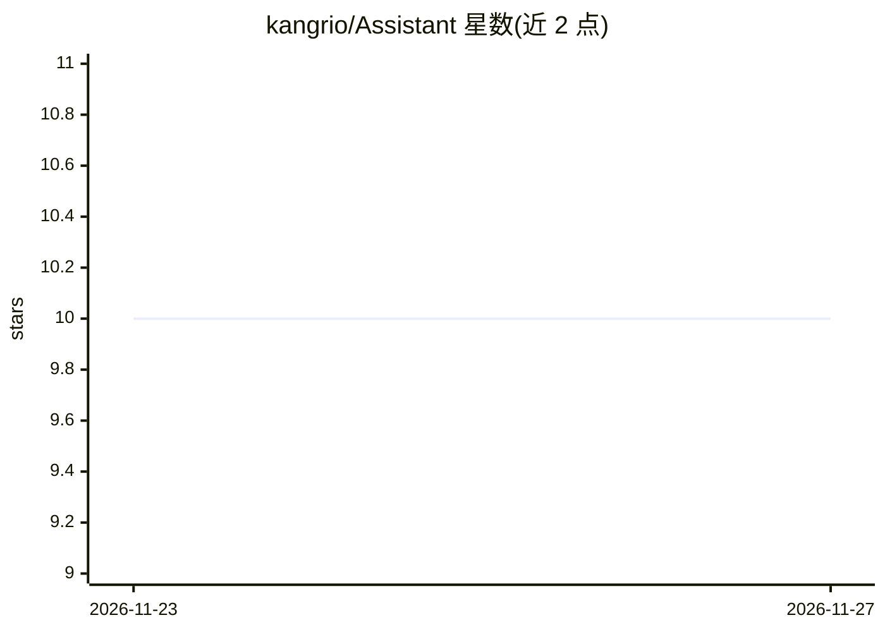

# kangrio/Assistant

⭐ 10 · C · MIT · 推送 2026-11-12 · [GitHub](https://github.com/kangrio/Assistant) · 个人维护

**面向比亚迪车机与安卓车机的一键唤醒 AI 语音助手启动器**

一款 Android 应用（com.kangrio.byd.assistant），针对比亚迪 DiLink 车机与自定义安卓车机/AOSP 设备：通过启动器图标、方向盘按键或桌面小组件一键唤起选定的语音助手（Google Assistant、ChatGPT 等），并提供基于 Snowboy 引擎的离线唤醒词检测（内置 Hey Rio/Alexa/Snowboy 模型），支持在应用内录制语音样本训练自定义 .pmdl 模型。通过写入 Settings.Secure 键将自身设为系统语音交互服务，引导式向导处理麦克风、悬浮窗、电池优化等权限，可用内置 dadb 本地 ADB 或手动 adb 命令授予 WRITE_SECURE_SETTINGS；开机自启动恢复服务。从源码构建需 Android Studio 与 Android SDK。

## 筛选速览

| 维度 | 判定 | 备注 |
|---|---|---|
| AI 角色 | `ai-enhanced` | 去掉 AI 部分产品仍成立 |
| 许可风险 | `permissive` | MIT |
| 部署形态 | `None` |  |
| 模型依赖 | — | README 未给出锁定关系 |
| 硬件要求 | — | 无带数字的原话,不猜 |
| 安装摩擦 | `low` | 无编译、无系统依赖或容器化 |
| 成熟度 | — | 结构信号不足 |

## 能力要点

- 一键启动选定语音助手（Google Assistant/ChatGPT/通用 ACTION_ASSIST）
- Snowboy 离线唤醒词检测，内置 3 个模型并支持应用内自定义训练
- 向导式权限引导，支持 dadb 本地 ADB 自动授予系统设置写入权限
- 开机自启动恢复语音唤醒服务

## 适用场景

- 在比亚迪车机上用方向盘按键快速唤起 ChatGPT 语音对话
- 给安卓车机加装自定义唤醒词的离线热词检测
- 把第三方语音助手设为车机系统默认助手

## 场景标签

 · 领域:车载/Android 工具

## 证据(README 行号)

> L7: **Assistant** (`com.kangrio.byd.assistant`) is an Android utility and voice interaction bridge tailored for BYD vehi
> L9: Launcher shortcuts directly to your preferred AI voice assistant (Google Assistant, ChatGPT, Perplexity, Claude, etc

## 星数曲线

2026-11-23 10 → 2026-11-27 10（+0）

---
*卡片 v1 · prompt 1.4 · 生成 2026-11-23 · 置信度 mid · 依据 README sha `a7a1e65c85a7` · [字段定义](../../DATASET.md)*
