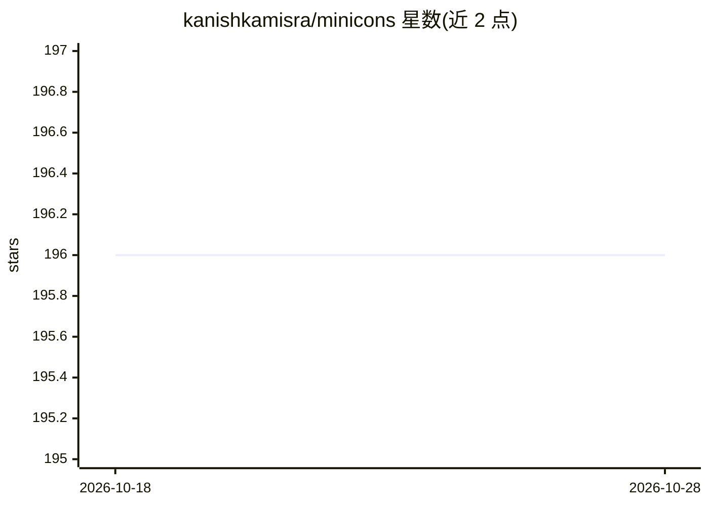

# kanishkamisra/minicons

⭐ 201 · Python · MIT · 推送 2026-10-06 · [GitHub](https://github.com/kanishkamisra/minicons) · [官网](https://kanishka.website/minicons) · 个人维护

**给科研者的 Transformer 语言模型行为与表征分析工具库**

基于 Hugging Face transformers 的 Python 包装库，面向语言模型的行为与表征分析：支持从上下文中抽取词表征（含 encoder 与 seq2seq 模型）、句子可接受度打分（surprisal/log-prob，含多种归约方式）、条件序列与逐 token 打分、Kauf & Ivanova 的改进 MLM 打分（within_word_l2r 等 PLL 度量），并新增视觉-语言模型（如 BLIP-2）打分。以 pip 包发布，附 arXiv 论文（2203.13112）与教程。

## 筛选速览

| 维度 | 判定 | 备注 |
|---|---|---|
| AI 角色 | `ai-ecosystem` | LLM/agent 周边工具 |
| 许可风险 | `permissive` | MIT |
| 部署形态 | `library` | 以包/库形式分发 |
| 模型依赖 | — | README 未给出锁定关系 |
| 硬件要求 | — | 无带数字的原话,不猜 |
| 安装摩擦 | `medium` | 含编译或系统依赖之一 |
| 成熟度 | — | 结构信号不足 |

## 能力要点

- 上下文词表征抽取，支持 BERT 类与 T5 类模型
- 序列 surprisal/log-prob 打分，支持 MLM/增量 LM/seq2seq 三类模型
- Kauf & Ivanova 改进版 MLM 逐 token 打分（多种 PLL 度量）
- 新增 VLMScorer 对 BLIP-2 等视觉-语言模型打分

## 适用场景

- 心理学/语言学实验中计算句子的模型 surprisal
- 分析词在不同上下文中的内部表征
- 对图文组合做视觉-语言模型合理性打分

## 场景标签

`科研工具` · 领域:学习与行业

## 证据(README 行号)

> L1: # minicons: Enabling Flexible Behavioral and Representational Analyses of Transformer Language Models
> L5: This repo is a wrapper around the `transformers` library from Hugging Face :hugs:

## 星数曲线

2026-10-18 196 → 2026-10-28 196（+0）

---
*卡片 v1 · prompt 1.4 · 生成 2026-10-22 · 置信度 high · 依据 README sha `f3cf4843ab40` · [字段定义](../../DATASET.md)*
