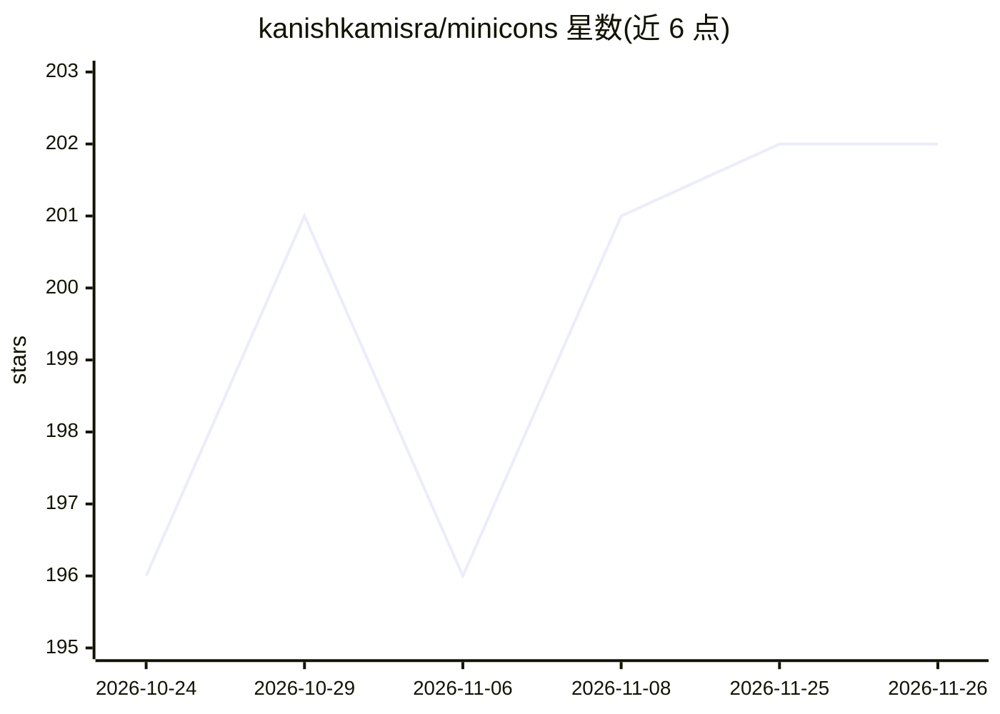

# kanishkamisra/minicons

⭐ 202 · Python · MIT · 推送 2026-11-23 · [GitHub](https://github.com/kanishkamisra/minicons) · [官网](https://kanishka.website/minicons) · 个人维护

**给NLP研究者提供Transformer语言模型行为与表征分析**

基于 Hugging Face transformers 库的 Python 封装，用于对 Transformer 语言模型做行为与表征分析。主要能力包括：提取上下文词嵌入（支持编码器与 seq2seq 模型）、计算句子的序列得分（surprisal、log-probability 等多种归约方式）、条件序列打分与逐 token 得分，以及视觉-语言模型打分。附教程与论文引用条目（arXiv:2203.13112）。需要 Python 3.11.5 以上版本。

## 筛选速览

| 维度 | 判定 | 备注 |
|---|---|---|
| AI 角色 | `ai-native` | 本体是模型或模型工具 |
| 许可风险 | `permissive` | MIT |
| 部署形态 | `library` | 以包/库形式分发 |
| 模型依赖 | — | README 未给出锁定关系 |
| 硬件要求 | — | 无带数字的原话,不猜 |
| 安装摩擦 | `medium` | 含编译或系统依赖之一 |
| 成熟度 | — | 结构信号不足 |

## 能力要点

- 提取上下文词嵌入，支持 BERT 类编码器与 T5 类 seq2seq 模型
- 序列打分支持 surprisal、log-probability 及按 token 数归约等多种归约方式
- 实现 Kauf & Ivanova 的改进 MLM 打分（within_word_l2r 等 PLL 指标）
- 新增视觉-语言模型打分（示例使用 blip2-opt-2.7b）

## 适用场景

- 计算句子在不同语言模型下的可接受度（surprisal）
- 为语言学/心理语言学实验提取词与句子的模型表征
- 对模型生成输出做逐 token 打分与排名
- 对比图文配对在不同 VLM 下的打分

## 场景标签

`科研工具` · 领域:学习与行业

## 证据(README 行号)

> L1: # minicons: Enabling Flexible Behavioral and Representational Analyses of Transformer Language Models
> L5: This repo is a wrapper around the `transformers` library from Hugging Face :hugs:
> L43: 2. Compute sentence acceptability measures (surprisals) using Language Models:

## 星数曲线

2026-10-24 196 → 2026-11-26 202（+6）

---
*卡片 v1 · prompt 1.4 · 生成 2026-11-25 · 置信度 high · 依据 README sha `9b8f9777b44c` · [字段定义](../../DATASET.md)*
