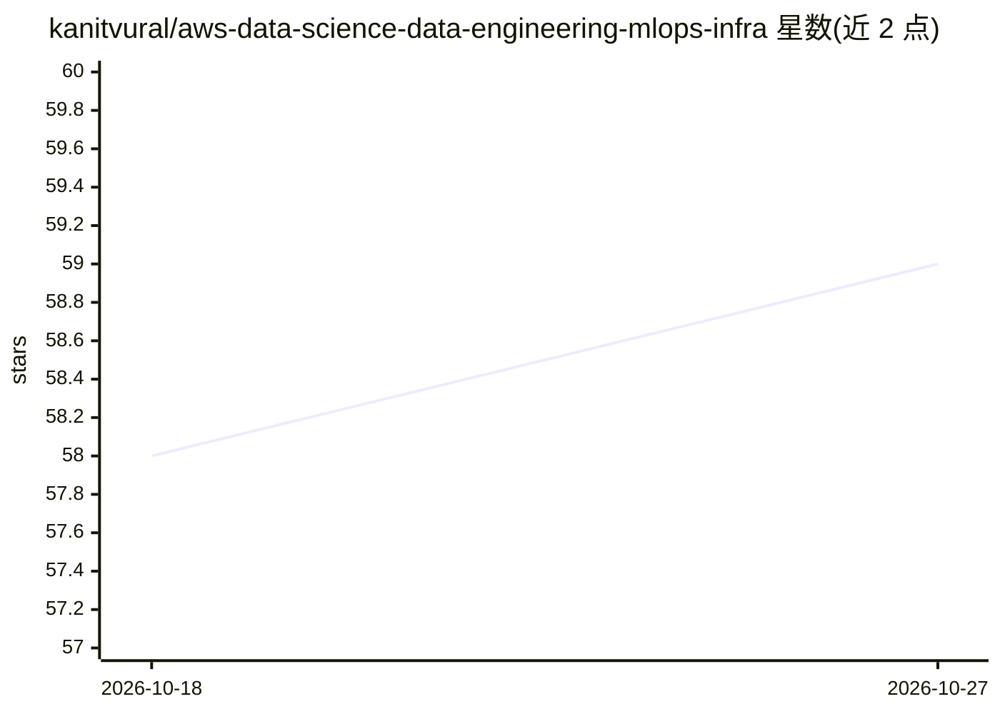

# kanitvural/aws-data-science-data-engineering-mlops-infra

⭐ — · [GitHub]() · 个人维护

**AWS 端到端数据与 AI 平台：实时航班延误预测 + 多 Agent 聊天**

用 AWS CDK 自变更流水线部署的一体化平台：Kinesis 实时摄取 Kaggle 航班数据，Glue Spark 做小时级 ETL 入 Redshift 供 Power BI 分析；SageMaker 完成 XGBoost 调参训练（RMSE<15 门控）、模型注册与多阶段部署、监控和 SHAP 分析；Next.js 15 仪表盘经 Cognito 认证展示实时预测，并接入基于 Bedrock Agent Core 的多 Agent LLM 聊天（文档问答、实时统计查询、限流与会话隔离）。面向数据/AI 团队与学习者，需自备 AWS 账号与多项前置工具，通过 git clone + CDK 部署。

## 筛选速览

| 维度 | 判定 | 备注 |
|---|---|---|
| AI 角色 | `ai-ecosystem` | LLM/agent 周边工具 |
| 许可风险 | `permissive` | — |
| 部署形态 | `self-host` | docker 或自建部署 |
| 模型依赖 | locked-api |  |
| 硬件要求 | — | 无带数字的原话,不猜 |
| 安装摩擦 | `low` | 无编译、无系统依赖或容器化 |
| 成熟度 | — | 结构信号不足 |

## 能力要点

- CDK 基础设施即代码 + 自变更 CI/CD 流水线统一部署全部组件
- SageMaker 全流程：Clarify 偏差检测、超参调优、模型注册、监控与自动重训
- Bedrock Agent Core 多 Agent 聊天：文档问答、DynamoDB 实时统计、Guardrail 内容过滤、每用户 20 请求/分钟限流
- Next.js 15 SSG + WebSocket 实时前端，Cognito 认证与 HttpOnly JWT 刷新

## 适用场景

- 搭建完整的 AWS 数据工程到 MLOps 参考架构
- 部署实时航班延误预测并带可视化仪表盘
- 演示数据/DS/MLOps/前端/AI 多角色协作的端到端流程

## 场景标签

`多智能体` `MLOps` `数据分析` `文档问答` · 领域:Agent 开发

## 证据(README 行号)

> L19: > **A production-ready AWS system integrating Data Engineering, Analytics, Data Science, MLOps, Web Applications, a
> L57: - **MLOps Engineers** deploy models to dev endpoints for testing, then promote to production with monitoring
> L66: - 🤖 **Production ML**: SageMaker Pipelines with automated retraining

## 星数曲线

2026-10-18 58 → 2026-10-27 59（+1）

---
*卡片 v1 · prompt 1.4 · 生成 2026-10-24 · 置信度 mid · 依据 README sha `4b4ec3af96f2` · [字段定义](../../DATASET.md)*
