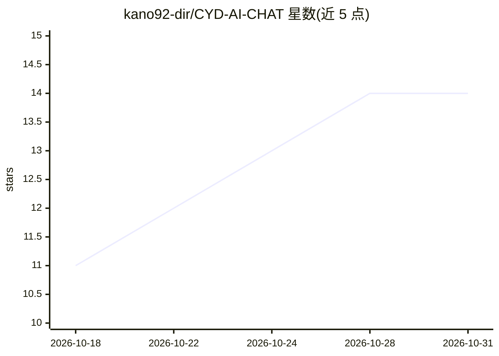

# kano92-dir/CYD-AI-CHAT

⭐ 14 · C++ · MIT · 推送 2026-06-06 · [GitHub](https://github.com/kano92-dir/CYD-AI-CHAT) · 个人维护

**ESP32 黄色便宜屏上的 AI 聊天终端，接入 OpenRouter 免费模型**

面向 ESP32-2432S028R（Cheap Yellow Display）开发板的开源 AI 客户端固件：通过 OpenRouter API 接入多种大模型对话，内置模型自动回退与可选 AI 人格；提供触屏聊天界面（消息气泡、触屏键盘、深色模式）、持久化聊天记录（重启后可恢复）、Wi-Fi 扫描与自动重连、RGB 状态灯与 RTC 同步。安装流程为克隆仓库后在 Arduino IDE 中编译上传，需自备 OpenRouter API key。流式输出、语音、TTS 等功能列为规划中未实现。

## 筛选速览

| 维度 | 判定 | 备注 |
|---|---|---|
| AI 角色 | `ai-native` | 本体是模型或模型工具 |
| 许可风险 | `permissive` | MIT |
| 部署形态 | `None` |  |
| 模型依赖 | locked-api |  |
| 硬件要求 | — | 无带数字的原话,不猜 |
| 安装摩擦 | `low` | 无编译、无系统依赖或容器化 |
| 成熟度 | — | 结构信号不足 |

## 能力要点

- OpenRouter API 集成，多模型选择与自动回退
- 持久化本地聊天记录，重启后可恢复会话
- 触屏聊天界面含深色模式与多语言（土耳其语/英语/俄语）
- 针对 ESP32-2432S028R 硬件优化的独立设备固件

## 适用场景

- 把 Cheap Yellow Display 做成独立 AI 聊天设备
- 用低成本 ESP32 硬件体验 OpenRouter 免费模型
- Maker 项目中搭建带持久记忆的桌面 AI 终端

## 场景标签

`聊天机器人` · 领域:对话与助手

## 证据(README 行号)

> L3: > Turn your Cheap Yellow Display (ESP32-2432S028R) into a powerful AI-powered smart terminal.
> L13: * OpenRouter API integration
> L80: * ESP32-2432S028R (Cheap Yellow Display)

## 星数曲线

2026-10-18 11 → 2026-10-31 14（+3）

---
*卡片 v1 · prompt 1.4 · 生成 2026-10-31 · 置信度 high · 依据 README sha `e5fbec8372ab` · [字段定义](../../DATASET.md)*
