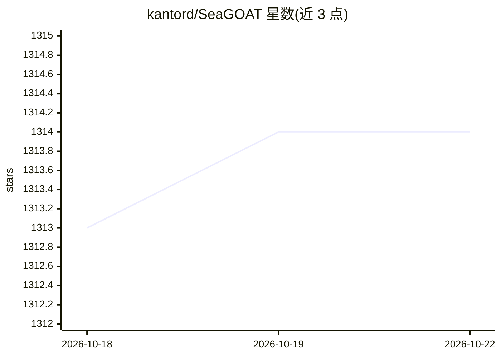

# kantord/SeaGOAT

⭐ 1,314 · Python · MIT · 推送 2026-10-04 · [GitHub](https://github.com/kantord/SeaGOAT) · [官网](https://kantord.github.io/SeaGOAT/) · 个人维护

**本地优先的语义代码搜索引擎，向量嵌入+正则检索**

面向开发者的代码搜索工具：在本地启动 SeaGOAT 服务器，对代码库建立向量嵌入（ChromaDB），以 gt/seagoat 命令做语义查询，查询中可混用正则表达式，同时结合 ripgrep 提供正则/关键词匹配。默认不依赖远程 API，生成式搜索（--generative）默认走本地 Ollama，可配置 openai/minimax 云端（需显式开启）。依赖 Python 3.10+ 与 ripgrep，bat 为可选；支持 12 类文本/代码文件格式，处理大仓库时低占用后台索引，索引完成前也可查询但结果带精度警告。服务器可自托管到其他机器，但自身不内置安全机制。

## 筛选速览

| 维度 | 判定 | 备注 |
|---|---|---|
| AI 角色 | `ai-enhanced` | 去掉 AI 部分产品仍成立 |
| 许可风险 | `permissive` | MIT |
| 部署形态 | `None` |  |
| 模型依赖 | local-ok | 支持本地模型 |
| 硬件要求 | — | 无带数字的原话,不猜 |
| 安装摩擦 | `low` | 无编译、无系统依赖或容器化 |
| 成熟度 | — | 结构信号不足 |

## 能力要点

- 向量嵌入（ChromaDB）+ ripgrep 的语义与正则混合检索
- 本地运行，默认无远程 API，离线可用
- --generative 生成式搜索默认本地 Ollama，云端 provider 需显式选择
- 支持 12 种文件格式，索引期间可查询并给出精度估计

## 适用场景

- 在大型代码库中用自然语言描述查找代码位置
- 语义查询中混用正则表达式精确定位
- 私有代码离线语义检索，不发送数据到第三方

## 场景标签

`语义搜索` · 领域:知识与检索

## 证据(README 行号)

> L7: A code search engine for the AI age. SeaGOAT is a local search tool that
> L8: leverages vector embeddings to enable you to search your codebase semantically.
> L208: mind that SeaGOAT is not a code generator but a code search engine, therefore
> L211: That being said, a language model *is* being used to generate vector

## 星数曲线

2026-10-18 1,313 → 2026-10-22 1,314（+1）

---
*卡片 v1 · prompt 1.4 · 生成 2026-10-21 · 置信度 high · 依据 README sha `f2eb3ef20503` · [字段定义](../../DATASET.md)*
