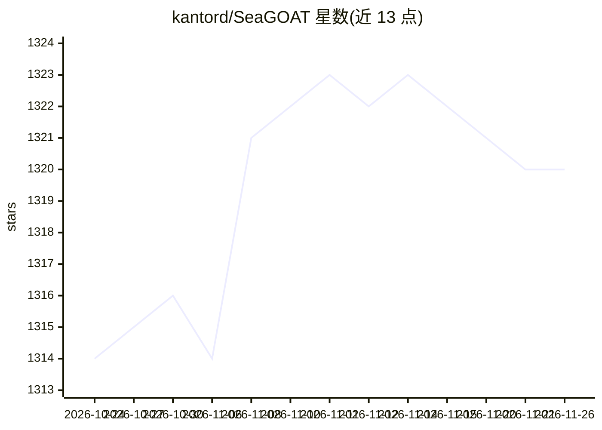

# kantord/SeaGOAT

⭐ 1,320 · Python · MIT · 推送 2026-11-23 · [GitHub](https://github.com/kantord/SeaGOAT) · [官网](https://kantord.github.io/SeaGOAT/) · 个人维护

**本地运行的语义代码搜索引擎，向量化检索代码库**

基于向量嵌入的本地代码搜索工具：通过常驻 server 对仓库建立向量索引（ChromaDB + 本地嵌入模型），支持自然语言语义查询与正则表达式查询，并结合 ripgrep 提供关键词/正则匹配结果。可选用 `--generative` 标志让 LLM 增强搜索结果，默认走本地 Ollama。全流程默认本地执行，不依赖第三方远程 API；支持 YAML 配置、远程自托管 server、.gitignore 过滤。通过 pipx 安装，依赖 Python 3.11-3.14 与 ripgrep，支持 12 种文本/编程语言格式。

## 筛选速览

| 维度 | 判定 | 备注 |
|---|---|---|
| AI 角色 | `ai-native` | 本体是模型或模型工具 |
| 许可风险 | `permissive` | MIT |
| 部署形态 | `None` |  |
| 模型依赖 | local-ok | 支持本地模型 |
| 硬件要求 | — | 无带数字的原话,不猜 |
| 安装摩擦 | `low` | 无编译、无系统依赖或容器化 |
| 成熟度 | — | 结构信号不足 |

## 能力要点

- 本地向量嵌入 + ChromaDB 的语义代码搜索，无第三方 API 依赖
- 语义结果与 ripgrep 正则/关键词结果结合返回
- 可选 generative 模式接 Ollama/OpenAI/MiniMax 增强
- server-client 架构，支持远程自托管与多仓库共用实例

## 适用场景

- 用自然语言在本地代码库中定位功能实现位置
- 语义搜索与正则搜索混合查询大型仓库
- 离线环境下对私有代码做语义检索

## 场景标签

`语义搜索` · 领域:知识与检索

## 证据(README 行号)

> L7: A code search engine for the AI age. SeaGOAT is a local search tool that
> L8: leverages vector embeddings to enable you to search your codebase semantically.
> L185: SeaGOAT does not rely on 3rd party APIs or any remote APIs and executes all
> L190: database called ChromaDB, with a local vector embedding engine and

## 星数曲线

2026-10-24 1,314 → 2026-11-26 1,320（+6）

---
*卡片 v1 · prompt 1.4 · 生成 2026-11-23 · 置信度 high · 依据 README sha `5a9648be1ded` · [字段定义](../../DATASET.md)*
