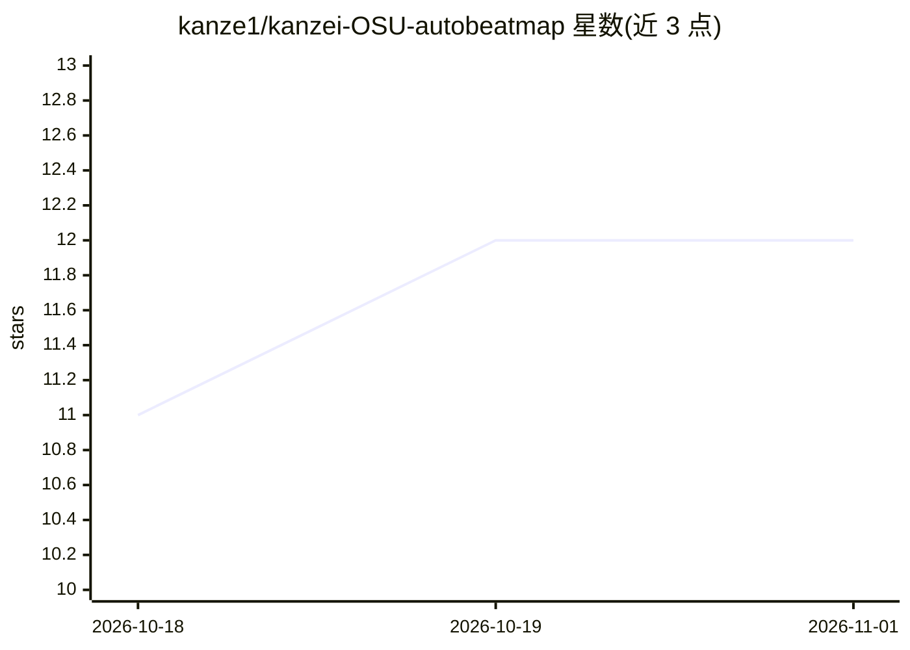

# kanze1/kanzei-OSU-autobeatmap

⭐ 12 · Python · NOASSERTION · 推送 2026-10-08 · [GitHub](https://github.com/kanze1/kanzei-OSU-autobeatmap) · 个人维护 · 中文 README

**把任意歌曲自动生成可游玩的 osu! 谱面的桌面工具**

面向 osu! 玩家的谱面自动生成器：输入音频（或视频自动抽音轨），经规则化的分析定时（onset/BPM/kiai 检测）加两个深度模型——约 2900 万参数的 MaskGIT 式节奏 Transformer 与约 1.3 亿参数的 DiT-B 坐标扩散模型——从约 14 万张真实谱面训练，一次输出四个难度的 .osz 并自动导入 osu!。提供中英双语 GUI、批量模式、CLI；Windows 有免安装 exe（模型内置），macOS/Linux 需源码运行，可选 NVIDIA GPU 加速，CPU 亦可用。生成谱面不可用于申请 Ranked。

## 筛选速览

| 维度 | 判定 | 备注 |
|---|---|---|
| AI 角色 | `ai-native` | 本体是模型或模型工具 |
| 许可风险 | `none` | NOASSERTION |
| 部署形态 | `desktop` | 安装包/桌面程序 |
| 模型依赖 | — | README 未给出锁定关系 |
| 硬件要求 | — | 无带数字的原话,不猜 |
| 安装摩擦 | `medium` | 含编译或系统依赖之一 |
| 成熟度 | `idea` | |

## 能力要点

- 节奏 Transformer + DiT-B 坐标扩散双模型，从约 14 万张真实谱面训练
- Windows 免安装 exe，模型内置，无需显卡（16 核 CPU 约 1 分钟/难度）
- 支持多格式音频/视频输入，文件夹批量生成与批次报告
- 难度/星级条件、highlight 控制、谱面偏好（跳跃/连打）与内容水印来源检查

## 适用场景

- 把喜欢的歌转成能直接游玩的 osu! 谱面
- 没有制谱能力但想打自定义歌曲的玩家
- 批量转换本地曲库并导入 osu!

## 场景标签

 · 领域:音乐游戏/生成式内容

## 证据(README 行号)

> L8: **丢进一首歌，一分钟后拿到一张能直接打的 osu!standard 谱面。**
> L27: 公开稳定版为 **0.2.0**，最新预览版为 **0.3.0rc3**，修复 GPU 安装长时间无反馈及取消失效的问题，节奏和坐标模型仍为 **v0**。已经能出让我自己愿意打完整首的图：节奏卡在鼓点上，跳和串都是从十几万张 r
> L206: **节奏模型** `rhythm_v0.pt`，约 2900 万参数。1/4 拍网格上的双向 Transformer：每个 tick 看 ±80 ms 的梅尔频谱、

## 星数曲线

2026-10-18 11 → 2026-11-01 12（+1）

---
*卡片 v1 · prompt 1.4 · 生成 2026-11-01 · 置信度 mid · 依据 README sha `4d9d4d80ea9b` · [字段定义](../../DATASET.md)*
