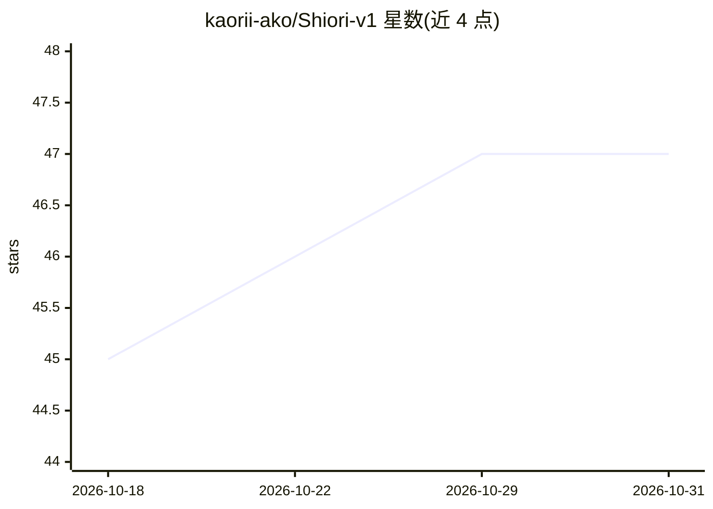

# kaorii-ako/Shiori-v1

⭐ 47 · JavaScript · MIT · 推送 2026-07-25 · [GitHub](https://github.com/kaorii-ako/Shiori-v1) · [官网](https://shiori-v1.vercel.app) · 个人维护

**面向学生的学习伴侣应用：测验、闪卡、成绩追踪与 AI 学习规划**

自托管的 Web 学习应用（React + Vite + Zustand 前端，Supabase 负责认证与数据）：提供 AI 测验生成、间隔重复闪卡、加权成绩计算与 GPA 预测、作业管理、Markdown 笔记、番茄钟、逐日学习计划与习惯追踪/XP/好友排行榜。AI 功能由用户自带 Gemini 1.5 Flash API key 在客户端调用，去掉 AI 后闪卡、成绩追踪、番茄钟等功能仍可用。含 Express 后端（仅 Stripe webhook）与 Chrome MV3 扩展目录，MIT 许可，提供在线 demo 与 Vercel 部署/源自托管两种方式。

## 筛选速览

| 维度 | 判定 | 备注 |
|---|---|---|
| AI 角色 | `ai-enhanced` | 去掉 AI 部分产品仍成立 |
| 许可风险 | `permissive` | MIT |
| 部署形态 | `library` | 以包/库形式分发 |
| 模型依赖 | — | README 未给出锁定关系 |
| 硬件要求 | — | 无带数字的原话,不猜 |
| 安装摩擦 | `low` | 无编译、无系统依赖或容器化 |
| 成熟度 | — | 结构信号不足 |

## 能力要点

- AI 测验生成与基于笔记的间隔重复闪卡
- 加权成绩计算与 GPA 预测
- 学习计划从课程大纲逐日生成
- 自带 Gemini API key 客户端调用，无订阅

## 适用场景

- 我要用笔记生成测验和闪卡来备考
- 追踪课程成绩并预测 GPA
- 按大纲生成每日学习计划并用番茄钟执行

## 场景标签

 · 领域:教育/生产力工具

## 证据(README 行号)

> L3: An AI study companion for students who actually care about their grades. Quizzes, flashcards, grade tracking, and st
> L9: - AI quiz generator and spaced-repetition flashcards from your notes
> L40: React + Vite + Zustand on the frontend, Supabase for auth and data, Gemini 1.5 Flash for AI (called client-side wit

## 星数曲线

2026-10-18 45 → 2026-10-31 47（+2）

---
*卡片 v1 · prompt 1.4 · 生成 2026-10-25 · 置信度 high · 依据 README sha `7fa95d7f7d69` · [字段定义](../../DATASET.md)*
