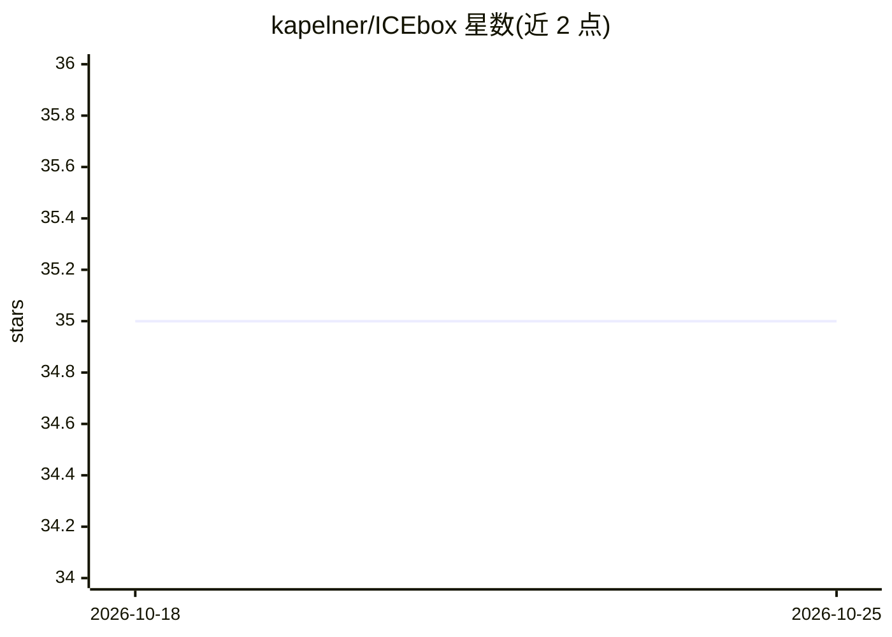

# kapelner/ICEbox

⭐ 35 · R · NOASSERTION · 推送 2026-09-03 · [GitHub](https://github.com/kapelner/ICEbox) · [官网](https://kapelner.github.io/ICEbox/) · 个人维护

**R 包：为任意监督学习模型绘制 ICE 曲线与偏依赖图，做可解释性诊断**

R 语言模型解释工具包，针对任意监督学习算法拟合的模型，绘制 Individual Conditional Expectation（ICE）曲线：对每个个体观测绘制预测响应与特征间的函数关系，呈现偏依赖图（PDP）均值曲线可能掩盖的异质效应与交互作用。提供绘图套件、数值导数 ICE、加性结构可视化检验（additivityLineup）及 clusterICE 聚类等；计算含 Rcpp 实现、data.table 与可选并行化加速。面向使用 R 做机器学习模型解释的数据分析与科研用户，方法论文为 Goldstein et al (2015)。安装提供 CRAN 与 R-universe 两种途径。

## 筛选速览

| 维度 | 判定 | 备注 |
|---|---|---|
| AI 角色 | `ai-ecosystem` | LLM/agent 周边工具 |
| 许可风险 | `viral` | NOASSERTION |
| 部署形态 | `None` |  |
| 模型依赖 | — | README 未给出锁定关系 |
| 硬件要求 | — | 无带数字的原话,不猜 |
| 安装摩擦 | `low` | 无编译、无系统依赖或容器化 |
| 成熟度 | — | 结构信号不足 |

## 能力要点

- 对任意监督学习模型绘制 ICE 曲线与偏依赖关系
- 可视化检验数据生成模型的加性结构（additivityLineup）
- clusterICE 聚类与数值导数 ICE（Savitzky-Golay 滤波，Rcpp 实现）
- ice/dice/clusterICE 支持可选并行化

## 适用场景

- 诊断黑箱模型中预测响应随特征变化的异质性
- 发现偏依赖图均值掩盖的交互效应
- 对模型加性假设做可视化检验

## 场景标签

 · 领域:机器学习可解释性/统计可视化

## 证据(README 行号)

> L9: This is the official repository for the R code for the R package ICEbox --- Individual Conditional Expectation (ICE)
> L1: # ICEbox: Individual Conditional Expectation Plots ICEbox hex logo

## 星数曲线

2026-10-18 35 → 2026-10-25 35（+0）

---
*卡片 v1 · prompt 1.4 · 生成 2026-10-25 · 置信度 high · 依据 README sha `e0bc06d7c956` · [字段定义](../../DATASET.md)*
