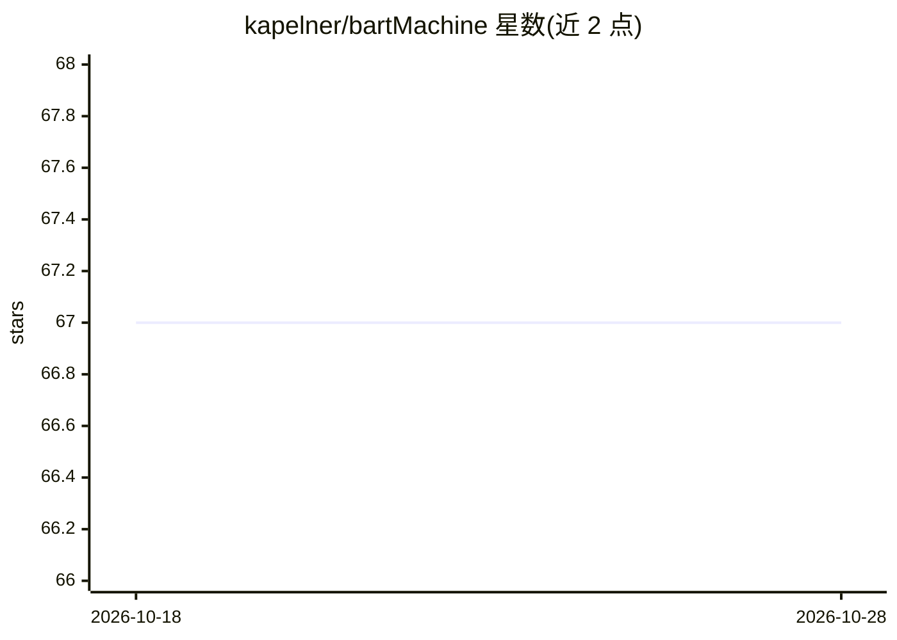

# kapelner/bartMachine

⭐ 67 · HTML · MIT · 推送 2026-09-03 · [GitHub](https://github.com/kapelner/bartMachine) · [官网](https://kapelner.github.io/bartMachine/) · 组织维护

**面向统计建模者的 R 贝叶斯加性回归树（BART）实现**

R 包形式的 BART 算法实现，基于 Java 后端，支持回归、分类、不确定性量化与变量选择等监督统计学习任务。作者来自纽约市立大学皇后学院与宾夕法尼亚大学沃顿商学院。版本 ≥1.4 需 Java JDK 21 并在加载前设置 JVM 参数（堆内存、Vector API、ZGC）；GPU 加速通过 TornadoVM 实现（CUDA/OpenCL/SPIR-V/Metal 后端），仅预测内核分发到 GPU，无 GPU 时透明回退 CPU。安装途径包括 CRAN、R-universe 与源码编译（需 Apache Ant），GPU 版需额外安装 TornadoVM。

## 筛选速览

| 维度 | 判定 | 备注 |
|---|---|---|
| AI 角色 | `ai-native` | 本体是模型或模型工具 |
| 许可风险 | `permissive` | MIT |
| 部署形态 | `None` |  |
| 模型依赖 | — | README 未给出锁定关系 |
| 硬件要求 | `cpu-ok` | |
| 安装摩擦 | `high` | 编译与系统依赖俱全 |
| 成熟度 | — | 结构信号不足 |

## 能力要点

- 回归/分类/不确定性量化/变量选择等监督学习功能
- 经 TornadoVM 的 GPU 预测加速（CUDA/OpenCL/SPIR-V/Metal），无 GPU 时回退 CPU
- ≥1.4 版本要求 Java JDK 21 与特定 JVM 参数设置
- 测试记录 ≥1,000 条时预测、后验样本、置信区间等操作分发到 GPU

## 适用场景

- 在 R 中做带不确定性量化的回归或分类建模
- 通过置换检验等方法进行变量选择与协变量重要性评估
- 在 GPU 上加速 BART 的后验预测计算

## 场景标签

 · 领域:统计机器学习

## 证据(README 行号)

> L15: An R-Java Bayesian Additive Regression Trees implementation (BART)
> L25: This is a Java implementation of the algorithm found in Chipman, George, & McCulloch

## 星数曲线

2026-10-18 67 → 2026-10-28 67（+0）

---
*卡片 v1 · prompt 1.4 · 生成 2026-10-24 · 置信度 high · 依据 README sha `774679d0a1a5` · [字段定义](../../DATASET.md)*
