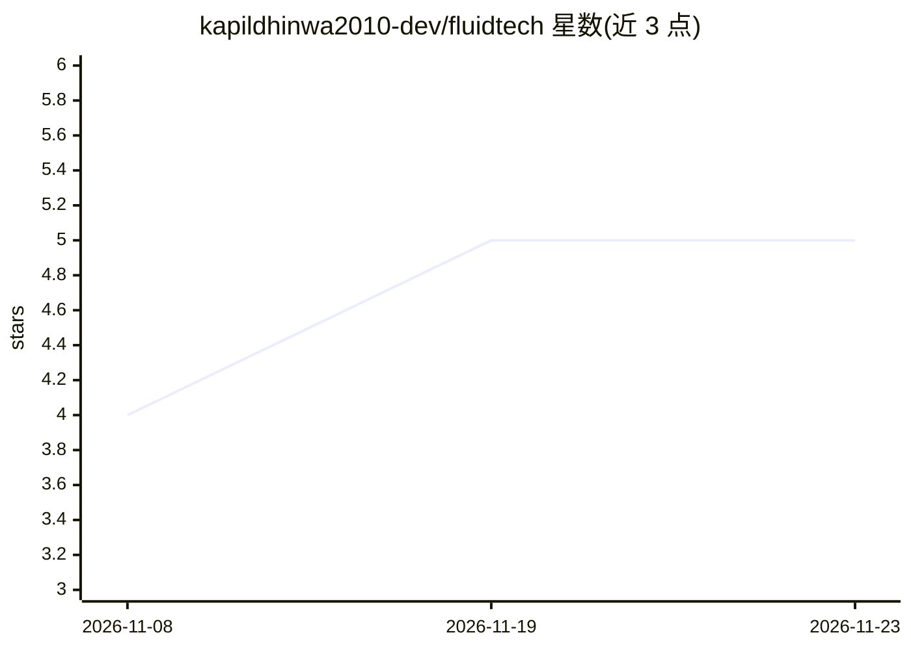

# kapildhinwa2010-dev/fluidtech

⭐ 5 · Python · MIT · 推送 2026-11-10 · [GitHub](https://github.com/kapildhinwa2010-dev/fluidtech) · 个人维护

**为 HuggingFace 因果语言模型附加的有界记忆层**

FluidLayer 是可附加到任意 HuggingFace 因果语言模型 forward hook 上的记忆层：12-gram 上下文精确存储实现已见上下文的原样回放召回，KV 缓存固定大小（默认 256），被逐出的 token 连同真实 hidden state 写入长期记忆。核心仅依赖 NumPy，PyTorch 适配为可选安装。附带 int8 量化、多 GPU 分片、GGUF 导出模块。作者声明各层均为未训练状态，附加不降低模型 loss，但也不提升困惑度，价值在于记忆行为本身。

## 筛选速览

| 维度 | 判定 | 备注 |
|---|---|---|
| AI 角色 | `ai-ecosystem` | LLM/agent 周边工具 |
| 许可风险 | `permissive` | MIT |
| 部署形态 | `library` | 以包/库形式分发 |
| 模型依赖 | — | README 未给出锁定关系 |
| 硬件要求 | `cpu-ok` | |
| 安装摩擦 | `medium` | 含编译或系统依赖之一 |
| 成熟度 | — | 结构信号不足 |

## 能力要点

- 有界 KV 缓存：内存随上下文长度 O(1)，逐出 token 存入长期记忆
- 12-gram 精确回放召回，已见上下文召回 0.9945（CI 实测）
- NumPy-only 核心，可选 PyTorch/GPU 安装路径
- 可选 int8 量化（4.0x 缩小）与 GGUF 导出

## 适用场景

- 为长上下文流式推理限制 KV 缓存内存占用
- 在 HuggingFace 因果模型上复现已见上下文的精确回放
- 以 CPU/NumPy 环境运行记忆层实验

## 场景标签

`Agent 记忆` · 领域:Agent 开发

## 证据(README 行号)

> L13: FluidLayer is a **memory layer you can attach on top of any HuggingFace
> L97: |**base + KV cache**|exact-tier store + bounded KV + long-term memory|**THE main layer — RECOMMENDED**|`fluidlayer/
> L205: - The layers are **untrained**: attaching them does not improve a model's loss (measured: Δ ≈ 0 on tiny-gpt2). The

## 星数曲线

2026-11-08 4 → 2026-11-23 5（+1）

---
*卡片 v1 · prompt 1.4 · 生成 2026-11-21 · 置信度 high · 依据 README sha `af83e808b62b` · [字段定义](../../DATASET.md)*
