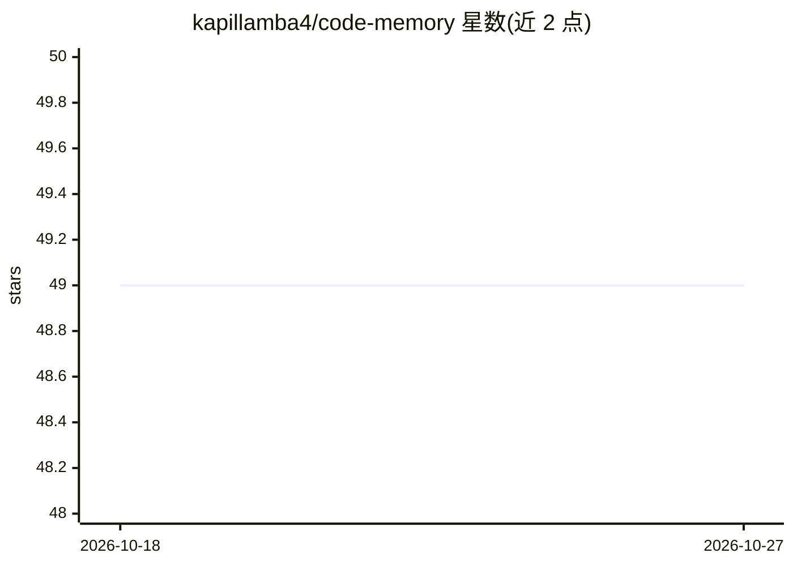

# kapillamba4/code-memory

⭐ 49 · Python · MIT · 推送 2026-05-20 · [GitHub](https://github.com/kapillamba4/code-memory) · [官网](https://pypi.org/project/code-memory/) · 个人维护

**本地离线的代码库语义检索 MCP server，供 AI 编码助手调用**

以 Model Context Protocol (MCP) server 形式提供的代码智能检索层：用 tree-sitter 做 AST 结构解析，sentence-transformers 本地生成嵌入，SQLite vec 存储，提供 index_codebase、search_code（BM25+向量混合）、search_docs（文档/语义）、search_history（Git 历史检索）四个工具，由 LLM 按问题类型选择检索策略。完全本地运行，无遥测、无 API key，支持 air-gapped 环境。限制：需 Python ≥3.13 或预编译二进制，首次运行下载约 600MB 嵌入模型（加载约 1GB RAM），SSE 端点默认无鉴权。

## 筛选速览

| 维度 | 判定 | 备注 |
|---|---|---|
| AI 角色 | `ai-ecosystem` | LLM/agent 周边工具 |
| 许可风险 | `permissive` | MIT |
| 部署形态 | `desktop` | 安装包/桌面程序 |
| 模型依赖 | locked-api |  |
| 硬件要求 | — | 无带数字的原话,不猜 |
| 安装摩擦 | `low` | 无编译、无系统依赖或容器化 |
| 成熟度 | — | 结构信号不足 |

## 能力要点

- tree-sitter AST 解析 + BM25/向量混合检索 + Git 历史三个检索工具
- 全离线运行：无遥测、无 API key、索引存本地 SQLite
- 支持 Gemini CLI、Claude Desktop/Code、VS Code 等 MCP host 接入
- 提供 SSE 共享实例模式以降低多项目内存占用，支持 air-gapped 部署

## 适用场景

- 让 AI 编码助手在大代码库中精准检索上下文而非整文件注入
- 在涉密或离线环境中为 IDE/Agent 提供本地代码搜索
- 通过 Git 历史检索定位回归原因与代码意图

## 场景标签

`语义搜索` · 领域:知识与检索

## 证据(README 行号)

> L9: A deterministic, high-precision **code intelligence layer** exposed as a Model Context Protocol (MCP) server.
> L38: |**"Where / What / How?"** — find definitions, references, structure, semantic search|`search_code`|BM25 + Dense Ve
> L284: Indexes or re-indexes source files and documentation in the given directory. Run this before using `search_code` o

## 星数曲线

2026-10-18 49 → 2026-10-27 49（+0）

---
*卡片 v1 · prompt 1.4 · 生成 2026-10-24 · 置信度 high · 依据 README sha `e67cf3937f35` · [字段定义](../../DATASET.md)*
