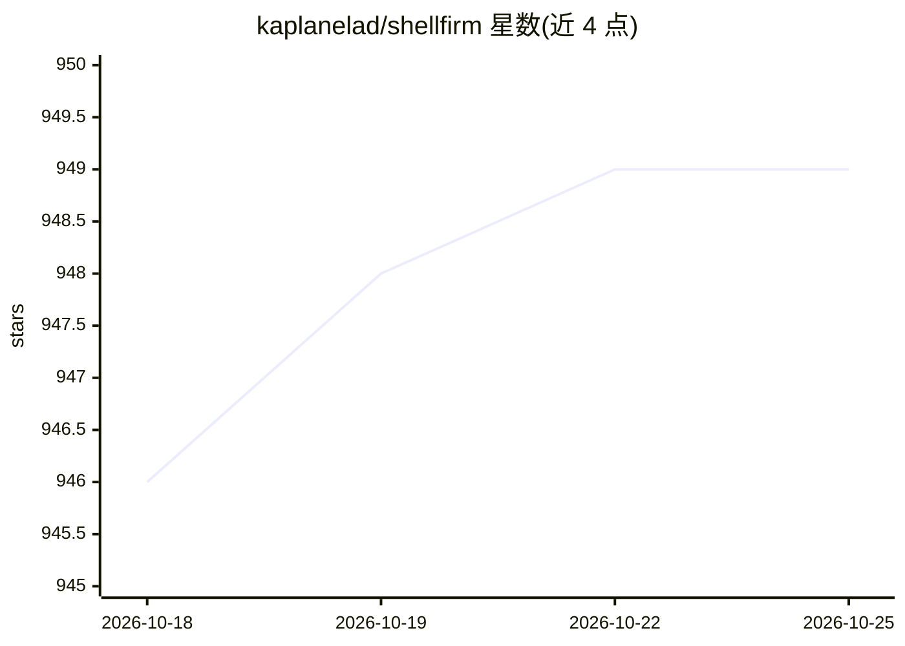

# kaplanelad/shellfirm

⭐ 949 · Rust · Apache-2.0 · 推送 2026-05-15 · [GitHub](https://github.com/kaplanelad/shellfirm) · [官网](https://shellfirm.vercel.app/) · 个人维护

**终端危险命令拦截工具，同时守护 AI 编码代理与人类**

以 Rust 编写的 shell 安全防护工具：通过 shell hook 在命令执行前拦截危险命令，内置 100+ 规则模式覆盖文件系统、git、Kubernetes、Terraform、Docker、云平台、数据库等 9 类生态，支持 Zsh/Bash/Fish 等 8 种 shell。提供分级严重度、安全替代命令建议、SSH/root/受保护分支等上下文感知升级、团队级 .shellfirm.yaml 策略与 JSON 审计日志。另内置 MCP server，可通过 shellfirm connect claude-code 一键接入 Claude Code 等 AI 代理，供其调用风险检查与分析工具。提供 npm、Homebrew、Cargo 及二进制安装。

## 筛选速览

| 维度 | 判定 | 备注 |
|---|---|---|
| AI 角色 | `ai-enhanced` | 去掉 AI 部分产品仍成立 |
| 许可风险 | `permissive` | Apache-2.0 |
| 部署形态 | `desktop` | 安装包/桌面程序 |
| 模型依赖 | locked-api |  |
| 硬件要求 | — | 无带数字的原话,不猜 |
| 安装摩擦 | `low` | 无编译、无系统依赖或容器化 |
| 成熟度 | — | 结构信号不足 |

## 能力要点

- 100+ 危险命令模式，覆盖 9 类生态（文件系统/git/K8s/Terraform/Docker/云平台等）
- 支持 8 种 shell，含 SSH/root/受保护分支的上下文感知升级
- MCP server 向 Claude Code、Cursor 等代理暴露 check_command 等 4 个工具
- 团队级 .shellfirm.yaml 策略（仅增强不削弱）与 JSON-lines 审计日志

## 适用场景

- 防止自己或 AI 代理误执行 rm -rf、force push 等危险命令
- 给 Claude Code 等 AI 编码工具加上命令执行前的安全检查
- 团队通过项目策略统一终端安全规则并留存审计记录

## 场景标签

`网络安全` · 领域:学习与行业

## 证据(README 行号)

> L5: Humans make mistakes. AI agents make them faster. shellfirm intercepts dangerous shell commands before the damage is
> L23: - **100+ patterns** across 9 ecosystems (filesystem, git, Kubernetes, Terraform, Docker, AWS, GCP/Azure, Heroku, da
> L31: - **MCP server** — expose shellfirm as an AI tool for Claude Code, Cursor, and other agents

## 星数曲线

2026-10-18 946 → 2026-10-25 949（+3）

---
*卡片 v1 · prompt 1.4 · 生成 2026-10-21 · 置信度 high · 依据 README sha `d8dc328ea2e1` · [字段定义](../../DATASET.md)*
