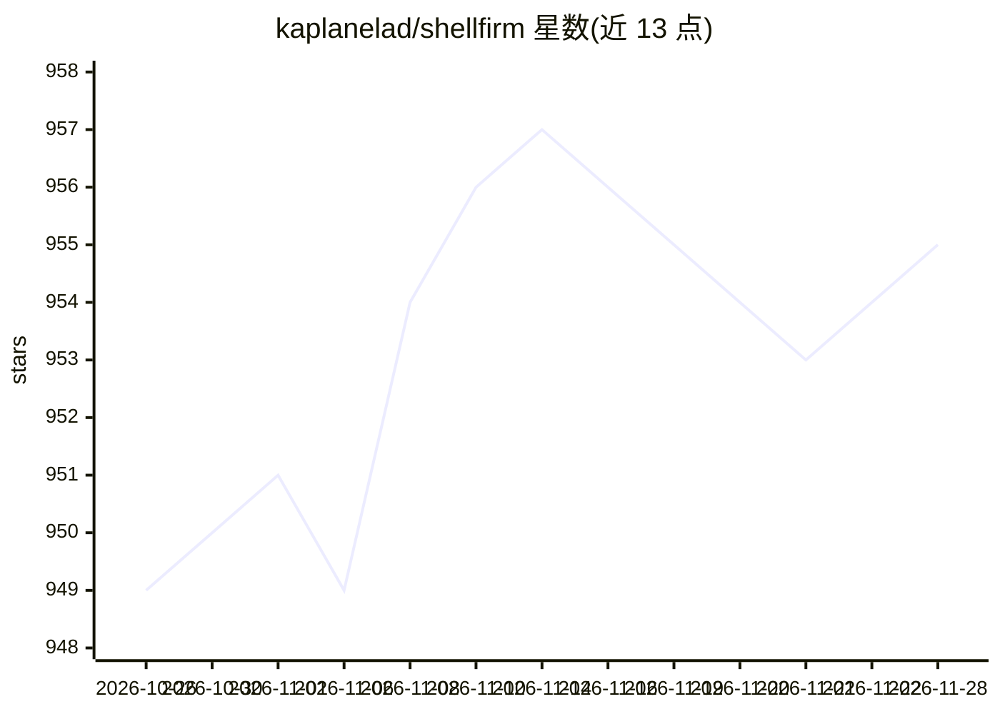

# kaplanelad/shellfirm

⭐ 955 · Rust · Apache-2.0 · 推送 2026-11-20 · [GitHub](https://github.com/kaplanelad/shellfirm) · [官网](https://shellfirm.vercel.app/) · 个人维护

**为终端命令与 AI coding agent 拦截危险 shell 命令的安全防护**

以 Rust 编写的 shell 命令安全防护工具：内置 512 项检查（23 组，覆盖 git、Kubernetes、Docker、云平台等），在危险命令执行前弹出确认挑战，拒绝名单直接阻断；按上下文（SSH、root、受保护分支、生产集群）升级挑战强度。为 8 种 shell 提供 hook，并可通过 `shellfirm connect` 为 Claude Code、Cursor、Codex CLI 等 9 个 AI agent 安装执行前 hook 与 MCP server；提供 JSONL 审计日志、过去 agent 会话的只读回放、爆炸半径分析与团队/组织级策略。通过 npm、Homebrew、Cargo 或预编译二进制安装。

## 筛选速览

| 维度 | 判定 | 备注 |
|---|---|---|
| AI 角色 | `ai-enhanced` | 去掉 AI 部分产品仍成立 |
| 许可风险 | `permissive` | Apache-2.0 |
| 部署形态 | `desktop` | 安装包/桌面程序 |
| 模型依赖 | locked-api |  |
| 硬件要求 | — | 无带数字的原话,不猜 |
| 安装摩擦 | `low` | 无编译、无系统依赖或容器化 |
| 成熟度 | — | 结构信号不足 |

## 能力要点

- 512 项内置检查覆盖 23 类工具，全部默认开启
- 为 8 种 shell 与 9 个 AI coding agent 安装执行前拦截 hook
- 按上下文（SSH/root/受保护分支/生产集群）升级确认挑战强度
- JSONL 审计日志与 agent 会话只读回放（不执行、不写入）

## 适用场景

- 防止人类误执行 git push --force、rm -rf 等破坏性命令
- 给 Claude Code、Cursor 等 AI agent 的 shell 操作加安全护栏
- 用团队共享的 .shellfirm.yaml 统一仓库级命令策略
- 上线前回放历史 agent 会话，看哪些命令本会被拦截

## 场景标签

`网络安全` · 领域:学习与行业

## 证据(README 行号)

> L5: Humans make mistakes. AI agents make them faster. shellfirm intercepts dangerous shell commands before the damage is
> L37: - **MCP server and agent hooks** — blocking hooks for Claude Code, Cursor, Codex CLI, Gemini CLI, Qwen Code, Copilo
> L44: One command sets up both automatic safety (hooks) and on-demand analysis (MCP):

## 星数曲线

2026-10-26 949 → 2026-11-28 955（+6）

---
*卡片 v1 · prompt 1.4 · 生成 2026-11-24 · 置信度 high · 依据 README sha `3119bb70a479` · [字段定义](../../DATASET.md)*
