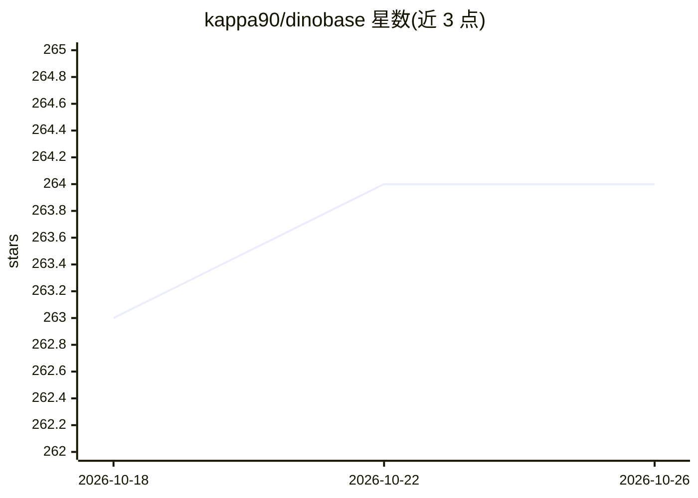

# kappa90/dinobase

⭐ 264 · Python · NOASSERTION · 推送 2026-07-06 · [GitHub](https://github.com/kappa90/dinobase) · 组织维护

**面向 AI agent 的数据平台：统一接入 100+ 数据源并以 SQL 查询**

面向构建 agent 应用的开发者的数据平台：将 SaaS API、数据库、文件与 MCP 服务器等 101 个连接器同步为各自 schema，数据落在 parquet（本地或 S3/GCS/Azure），由 DuckDB 作为查询引擎；agent 通过一条 SQL 实现跨连接器 JOIN 与聚合，也可经预览/确认流程用 SQL 反向写回上游 API。提供 CLI 与 MCP server 两种接入方式，可写入 Claude Code、Cursor、Claude Desktop 等工具的配置；可选语义层用 Claude agent 自动标注表描述、列文档与 PII 标记（需 Anthropic API key）。README 附有 11 个 LLM 上的自测基准（91% vs 35% 准确率）。MIT 许可。

## 筛选速览

| 维度 | 判定 | 备注 |
|---|---|---|
| AI 角色 | `ai-ecosystem` | LLM/agent 周边工具 |
| 许可风险 | `none` | NOASSERTION |
| 部署形态 | `library` | 以包/库形式分发 |
| 模型依赖 | locked-api |  |
| 硬件要求 | — | 无带数字的原话,不猜 |
| 安装摩擦 | `low` | 无编译、无系统依赖或容器化 |
| 成熟度 | — | 结构信号不足 |

## 能力要点

- 101 个连接器（SaaS API、数据库、文件、任意 MCP 服务器）统一为可 SQL 查询的 schema
- 跨连接器 SQL JOIN 与带预览/确认的反向 ETL 写回
- CLI 与 MCP server 双接入，一键写入 Claude Code/Cursor/Claude Desktop 等配置
- 可选语义层：Claude agent 自动生成表描述、列文档、PII 标记与关系图

## 适用场景

- 让 agent 用一条 SQL 回答跨多个 SaaS/数据库的业务问题
- 通过 Claude Desktop 或 Cursor 等 MCP 客户端直接查询公司数据
- agent 需要带审核地写回 Stripe 等上游 API 数据
- 为 agent 数据表补充语义上下文（描述、PII 标记）

## 场景标签

`数据分析` · 领域:效率与自动化

## 证据(README 行号)

> L5:  The data platform for agents.
> L18: Dinobase is the data platform that fills it. Plug in every source: each connector (SaaS APIs, databases, files, MCP

## 星数曲线

2026-10-18 263 → 2026-10-26 264（+1）

---
*卡片 v1 · prompt 1.4 · 生成 2026-10-22 · 置信度 mid · 依据 README sha `5985e3868490` · [字段定义](../../DATASET.md)*
