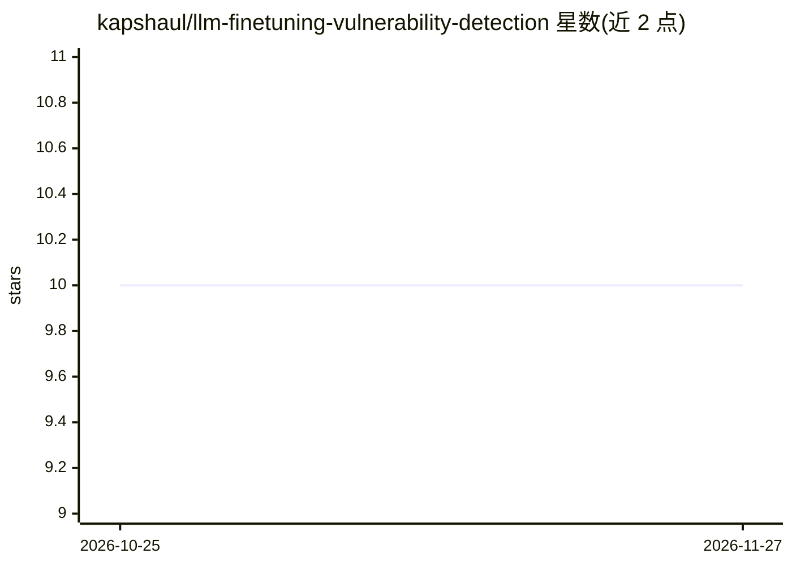

# kapshaul/llm-finetuning-vulnerability-detection

⭐ 10 · Python · 推送 2026-09-29 · [GitHub](https://github.com/kapshaul/llm-finetuning-vulnerability-detection) · 组织维护

**复现论文的 LLM 代码漏洞检测微调研究项目**

Oregon State University 的课程研究项目，复现 Shestov et al. (2024) 的 Java 函数漏洞二分类研究：LLM 编码函数、分类头预测是否漏洞，原研究用 LoRA，本项目改为 QLoRA（4-bit 量化权重加低秩适配器）并记录序列长度与长函数处理对结果的影响。README 明确声明这是研究快照而非可用包：run.py 存在缩进错误与占位导入路径，依赖未固定，模型权重、适配器检查点与训练日志均未包含。

## 筛选速览

| 维度 | 判定 | 备注 |
|---|---|---|
| AI 角色 | `ai-knowledge` | 知识聚合/清单类 |
| 许可风险 | `none` | — |
| 部署形态 | `None` |  |
| 模型依赖 | — | README 未给出锁定关系 |
| 硬件要求 | — | 无带数字的原话,不猜 |
| 安装摩擦 | `low` | 无编译、无系统依赖或容器化 |
| 成熟度 | `idea` | |

## 能力要点

- 用 QLoRA（4-bit NormalFloat 量化 + LoRA）适配上游 LoRA 训练代码
- 附带两个 Java 漏洞数据集档案（with P₃ 共 22,954 条样本）
- 提供训练与评估入口：训练、评估适配器、无适配器评估三种模式
- 报告最佳 QLoRA 结果为 ROC AUC 0.72，并引用上游 LoRA 基线 0.86

## 适用场景

- 复现或核对 Shestov et al. 2024 漏洞检测微调实验
- 研究序列长度与长函数处理方式对分类结果的影响
- 学习 LoRA/QLoRA 微调分类头的实现细节

## 场景标签

`微调` `模型量化` · 领域:训练与推理

## 证据(README 行号)

> L5: A course research project at Oregon State University that reproduces *Finetuning Large Language Models for Vulnerabi
> L9: > **Current status:** this repository is a research snapshot, not a turnkey package. `run.py` contains an indentatio
> L44: |Java datasets|Both archives are included. Each holds `train.jsonl`, `valid.jsonl`, and `test.jsonl`; the loader us

## 星数曲线

2026-10-25 10 → 2026-11-27 10（+0）

---
*卡片 v1 · prompt 1.4 · 生成 2026-11-19 · 置信度 high · 依据 README sha `f9768c57c959` · [字段定义](../../DATASET.md)*
