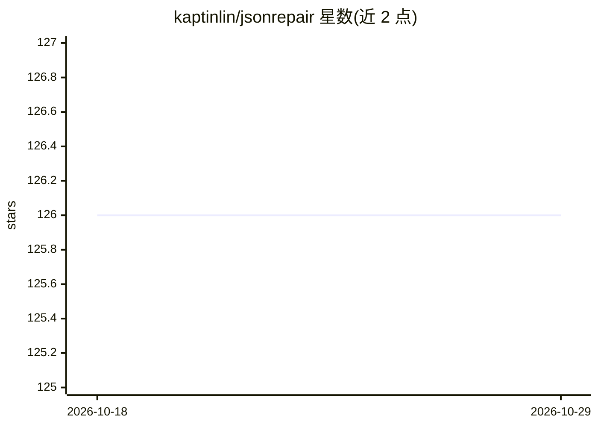

# kaptinlin/jsonrepair

⭐ 126 · Go · MIT · 推送 2026-10-25 · [GitHub](https://github.com/kaptinlin/jsonrepair) · 个人维护

**修复畸形 JSON 文本的 Go 库，适配 LLM 输出场景**

提供单一 Repair(text) API，将畸形 JSON 及 JSON 邻近格式文本修复为合法 JSON：补全缺失引号、逗号、冒号与闭合括号，规范单引号/智能引号，移除 JS 注释与 Markdown 代码围栏、JSONP 回调、MongoDB 包装，转换 Python 字面量（None/True/False），修复截断字符串，并可把 NDJSON 合并为 JSON 数组。修复失败时返回结构化 *jsonrepair.Error，含 6 类哨兵错误支持 errors.Is。需 Go 1.26.4+，是 Jos de Jong JavaScript 版 jsonrepair 的 Go 移植。

## 筛选速览

| 维度 | 判定 | 备注 |
|---|---|---|
| AI 角色 | `ai-ecosystem` | LLM/agent 周边工具 |
| 许可风险 | `permissive` | MIT |
| 部署形态 | `None` |  |
| 模型依赖 | — | README 未给出锁定关系 |
| 硬件要求 | — | 无带数字的原话,不猜 |
| 安装摩擦 | `low` | 无编译、无系统依赖或容器化 |
| 成熟度 | — | 结构信号不足 |

## 能力要点

- 补全缺失语法：引号、逗号、冒号、闭合括号
- 剥离 Markdown 代码围栏、JSONP 回调、MongoDB 包装等外层结构
- Python 字面量（None/True/False）转 JSON 字面量
- NDJSON 转 JSON 数组；失败时返回结构化错误支持 errors.Is

## 适用场景

- 我在解析 LLM 生成的 JSON 时需要先修复再反序列化
- 我的数据管道接收用户粘贴的类 JSON 文本，需要容错解析
- 我把 NDJSON 日志转成一个合法 JSON 数组

## 场景标签

 · 领域:开发者工具/文本处理

## 证据(README 行号)

> L3: A Go library that repairs malformed JSON and JSON-adjacent text into valid JSON
> L41: func Repair(text string) (string, error)

## 星数曲线

2026-10-18 126 → 2026-10-29 126（+0）

---
*卡片 v1 · prompt 1.4 · 生成 2026-10-23 · 置信度 mid · 依据 README sha `4c67feef18ec` · [字段定义](../../DATASET.md)*
