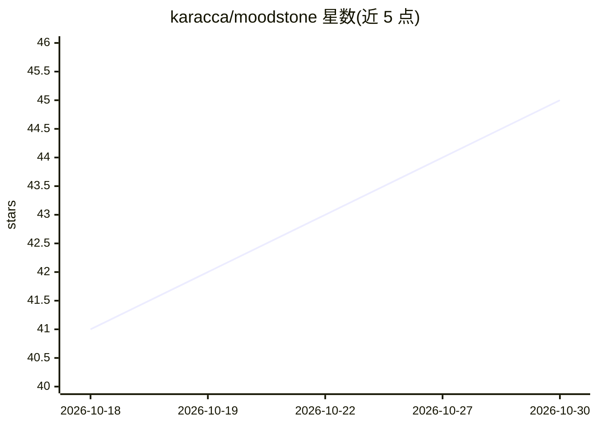

# karacca/moodstone

⭐ 45 · TypeScript · MIT · 推送 2026-09-12 · [GitHub](https://github.com/karacca/moodstone) · [官网](https://moodstone.expo.app) · 个人维护

**给 React Native AI agent 的程序化生成动画头像组件库**

面向 React Native 开发者的 npm 组件库：为 AI agent 渲染程序化生成的动画头像，传入 mood（idle/thinking/working 等 9 种）即触发对应表情循环，由 React Native Skia 在 UI 线程渲染。支持 7 种轮廓、12 种配色与自定义形状参数，提供 PNG/SVG 导出（含 SMIL 动画 SVG）及无 React Native 依赖的 core 层。需要 React 19+、React Native 0.78+、Skia 2+、Reanimated 4+ 与 Worklets 0.7+。附带 Expo 示例应用与浏览器 WebAssembly 版本。

## 筛选速览

| 维度 | 判定 | 备注 |
|---|---|---|
| AI 角色 | `ai-ecosystem` | LLM/agent 周边工具 |
| 许可风险 | `permissive` | MIT |
| 部署形态 | `library` | 以包/库形式分发 |
| 模型依赖 | — | README 未给出锁定关系 |
| 硬件要求 | — | 无带数字的原话,不猜 |
| 安装摩擦 | `low` | 无编译、无系统依赖或容器化 |
| 成熟度 | — | 结构信号不足 |

## 能力要点

- 9 种 mood 循环动画，7 种轮廓可互相形变
- UI 线程渲染，JS 线程不参与动画
- PNG/SVG 导出，含 SMIL 无缝循环动画 SVG
- core 模块无 React Native 依赖，纯函数描述每一帧

## 适用场景

- 在聊天或 agent 应用中展示 agent 当前状态的表情头像
- 静态列表中用关键帧头像降低开销
- 通过 CLI 或 SVG 导出批量生成头像素材

## 场景标签

 · 领域:前端 UI 组件/agent 界面

## 证据(README 行号)

> L8: Animated, procedurally generated avatars for AI agents in React Native. Give an agent a mood and the face reacts. Re
> L37: |Mood|Cut|Color|Preview|When the agent is…|

## 星数曲线

2026-10-18 41 → 2026-10-30 45（+4）

---
*卡片 v1 · prompt 1.4 · 生成 2026-10-25 · 置信度 high · 依据 README sha `ee3782b0a5d4` · [字段定义](../../DATASET.md)*
